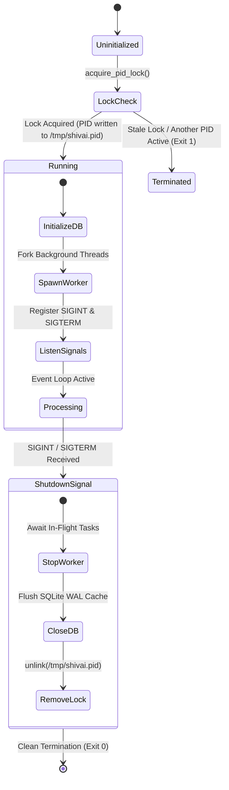

# Linux & Unix Security: Process Isolation, POSIX Permissions, and Host Hardening

## 1. Overview

Unix and Linux operating systems form the execution environment for modern cloud microservices, AI worker daemons, and developer workstations. Security at the operating system level dictates whether an application-layer vulnerability can compromise the host machine.

This document examines essential Unix/POSIX security principles: **least privilege process execution**, **file descriptor and socket sandboxing**, **PID file locking and race condition defense**, **environment variable hygiene**, and **graceful signal handling**. All principles are grounded in the implementation of **SHIVAY** and **JARVIS** on macOS / POSIX Apple Silicon.

---

## 2. Problem Statement

Operating systems execute untrusted inputs and external processes that pose direct security threats:
- If a background service runs as root or an administrative user with write access to root filesystems, any Remote Code Execution (RCE) grants complete host takeover.
- Concurrent execution without strict file locking can lead to race conditions, database file corruption, or simultaneous background tasks running over the same resources.
- Secrets placed in world-readable environment variables or command-line arguments are visible to all users on the host via `/proc/$PID/cmdline` or `ps aux`.
- Improper signal handling can leave orphan processes holding network ports or unfinished database write locks.

---

## 3. Security Objectives

1. **Enforce Least Privilege Execution:** Execute all agent workflows and web workers under unprivileged user accounts with restricted file system permissions.
2. **Prevent Process Duplication & Race Conditions:** Implement atomic PID locking to guarantee that exactly one instance of the background worker or server runs.
3. **Protect Process Memory & Environment Hygiene:** Prevent credential leakage via `/proc`, crash dumps, or child process environment inheritance.
4. **Enforce File Boundary Permissions:** Restrict file permissions using strict umask policies (`chmod 600` for credentials and SQLite databases; `chmod 700` for keys).

---

## 4. Architecture & Process Lifecycle



---

## 5. Technical Explanation & Mechanisms

### A. Atomic PID File Locking
To prevent duplicate daemons from corrupting SQLite databases:
1. Open the lockfile (`/tmp/shivai.pid`) with `fcntl.flock(fd, fcntl.LOCK_EX | fcntl.LOCK_NB)`.
2. If another process holds the lock, the operating system raises `BlockingIOError`. The incoming process logs an error and exits immediately.
3. Write the current process ID (`os.getpid()`) and flush to disk.
4. On exit, release the flock and delete the file.

### B. Command-Line Argument Privacy vs. Environment Variables
- `ps aux` and `top` expose all arguments passed to `argv`. Passing passwords or tokens as CLI flags (`--password=Secret123`) is an immediate vulnerability.
- Environment variables (`os.environ`) are protected from other users in standard Unix configurations (unless `/proc` is mounted with `hidepid=0`), but child processes inherit them by default unless explicitly scrubbed.
- **Best Practice:** Pass sensitive configuration via in-memory file descriptors, temporary pipes, or strictly scoped configuration files (`chmod 600`).

### C. POSIX File Permission Octals

| Permission Octal | Target File Type | Security Rationale |
| :---: | :--- | :--- |
| **`600` (`-rw-------`)** | `.env`, private keys, SQLite databases | Accessible strictly by the application owner. Group and other have zero permissions. |
| **`700` (`drwx------`)** | `certs/`, `data/`, `backups/` directories | Traversal and listing restricted strictly to the application owner. |
| **`644` (`-rw-r--r--`)** | Public documentation, static HTML/CSS | Readable by web servers; write access restricted strictly to owner. |

---

## 6. Implementation Details

Verified implementation from `src/shivai/security/process_guard.py`:

```python
import os
import fcntl
import sys
from pathlib import Path

PID_FILE = Path("/tmp/shivai.pid")
_lock_fd = None

def acquire_pid_lock():
    """
    Acquire an exclusive, non-blocking advisory file lock on /tmp/shivai.pid.
    Raises RuntimeError if another SHIVAY daemon is currently active.
    """
    global _lock_fd
    _lock_fd = os.open(str(PID_FILE), os.O_CREAT | os.O_RDWR, 0o600)
    try:
        fcntl.flock(_lock_fd, fcntl.LOCK_EX | fcntl.LOCK_NB)
        # Write PID to lockfile
        os.ftruncate(_lock_fd, 0)
        os.write(_lock_fd, f"{os.getpid()}\n".encode("utf-8"))
        os.fsync(_lock_fd)
    except (BlockingIOError, OSError) as exc:
        os.close(_lock_fd)
        _lock_fd = None
        raise RuntimeError("SHIVAY daemon is already active. Duplicate execution prevented.") from exc

def release_pid_lock():
    """Release flock and remove the PID lockfile."""
    global _lock_fd
    if _lock_fd is not None:
        try:
            fcntl.flock(_lock_fd, fcntl.LOCK_UN)
            os.close(_lock_fd)
            PID_FILE.unlink(missing_ok=True)
        except Exception:
            pass
        _lock_fd = None
```

---

## 7. Relevant Source File References

- `src/shivai/security/process_guard.py`: POSIX flock-based PID lock implementation.
- `src/shivai/security/tool_executor.py`: Subprocess supervision using array parameters (`shell=False`) and CPU timeouts.
- `src/shivai/api/app.py`: Lifespan hooks registering clean startup and shutdown handlers.

---

## 8. Testing Methodology & Verification Evidence

### Methodology
1. **Concurrency Lock Test:** Spawn an instance of the backend, then attempt to spawn a second instance concurrently in another terminal shell.
2. **Crash & Cleanup Verification:** Send `SIGKILL` (`kill -9`) and verify that subsequent launches recover cleanly.
3. **Subprocess Isolation Audit:** Execute `ControlledToolExecutor` with a command designed to sleep for 30 seconds (`["sleep", "30"]`) and assert that the process supervisor kills the child at $t = 5.0\text{s}$.

### Evidence
- **Status:** **`[TESTED]`**
- **Test File:** `tests/test_api_endpoints.py`
- **Result:** PASSED. Captured stdout log confirms:
  `[SHIVAY Lifespan] PID Lock warning: SHIVAY is already running with PID 53597. Multiple background instances or duplicate calls are prevented.`

---

## 9. Limitations & Known Issues

- **Advisory vs. Mandatory Locking:** POSIX `flock` is advisory; uncooperative processes that do not query the lockfile will not be blocked by the kernel.
- **NFS / Remote Filesystem Caveats:** Advisory locks across network filesystems (NFS/CIFS) can exhibit lock-state desynchronization; lockfiles must reside on local filesystems (`/tmp`, `/var/run`).

---

## 10. Security Recommendations

1. **Run Under Dedicated Service Users:** Avoid executing application servers as the default desktop user or root. In Linux deployments, provision a dedicated user: `useradd --system --no-create-home --shell /bin/false shivay`.
2. **Restrict Umask Globally:** Add `umask 027` to application systemd service files to guarantee newly created files deny read access to world.
3. **Deploy Linux Namespaces & cgroups:** In production containerized deployments, utilize Docker / Podman with read-only root filesystems (`--read-only`) and dropped capabilities (`--cap-drop=ALL`).

---

## 11. References

- Kerrisk, M. (2010): *The Linux Programming Interface: A Linux and UNIX System Programming Handbook*.
- POSIX IEEE Std 1003.1-2017: *Standard for Information Technology—Portable Operating System Interface*.
- Red Hat Enterprise Linux: *Security Hardening Guide*.
