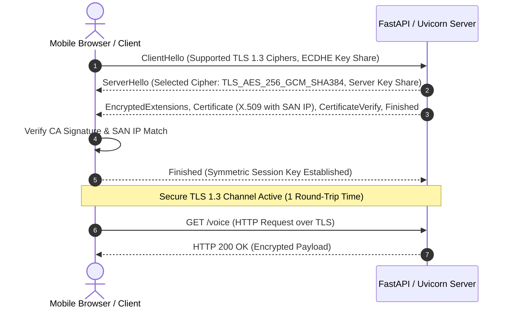

# Networking Fundamentals: Protocols, TLS 1.3, WebRTC, and Network Isolation

## 1. Overview

Computer networking provides the transport infrastructure through which distributed applications communicate. In cybersecurity, understanding OSI layers, TCP socket behaviors, TLS handshakes, and local network topologies is essential for securing client-server connections and diagnosing real-world connection failures.

This document examines transport-layer security, TLS 1.3 certificate validation, WebRTC media streaming protocols, and local area network isolation mechanics—grounded in real-world engineering data from the **JARVIS** real-time voice evaluation and **SHIVAY** network services.

---

## 2. Problem Statement

Network communication exposes systems to eavesdropping, man-in-the-middle (MitM) interception, spoofing, and routing manipulation:
- Unencrypted HTTP transports permit plaintext credential harvesting.
- Self-signed certificates without explicit Subject Alternative Name (SAN) IP bindings are rejected by modern mobile WebRTC clients (Android Chrome, iOS Safari).
- Enterprise Wi-Fi networks frequently enforce security controls (such as Access Point Client Isolation) that drop inter-device peer-to-peer packets, leading to cryptic `ERR_EMPTY_RESPONSE` failures.
- WebRTC real-time voice agents require bidirectional low-latency UDP streams through NAT boundaries while enforcing cryptographic room access controls.

---

## 3. Security Objectives

1. **Mandate Encrypted Transport:** Enforce TLS 1.3 with forward secrecy (ECDHE) for all HTTP/WebSocket traffic.
2. **Strict Certificate Binding:** Author development and production X.509 certificates containing exact SAN IP and DNS records matching the host interface.
3. **Resilient NAT Traversal:** Implement WebRTC ICE (Interactive Connectivity Establishment), STUN, and TURN protocols with ephemeral session credentials.
4. **Network Perimeter Isolation:** Bind internal management endpoints strictly to loopback (`127.0.0.1`), while exposing public ingress on dedicated ports guarded by rate limiters.

---

## 4. Architecture & Protocol Handshake Workflows

### A. TLS 1.3 Modern Handshake (Zero Round-Trip Resumption & Forward Secrecy)



### B. Enterprise Network AP Client Isolation Anatomy

During mobile testing, requests to `https://10.107.29.188:8443/voice` failed with `ERR_EMPTY_RESPONSE`:

```
┌────────────────────────────────────────────────────────┐
│ Enterprise Campus Access Point (Wi-Fi 802.11)         │
│                                                        │
│  [MacBook: 10.107.29.188:8443]                         │
│         ▲                                              │
│         │ (TCP SYN Handshake Dropped by AP Switch)     │
│         ✕                                              │
│  [Physical Phone: 10.107.x.x]                          │
│                                                        │
│  RULE: AP Client Isolation = ENABLED (Blocks Intra-BSS)│
└────────────────────────────────────────────────────────┘
```
**Resolution:** Migration to a dedicated private Personal Hotspot where Client Isolation is disabled allowed direct TCP SYN/ACK handshakes to complete.

---

## 5. Technical Explanation & Protocols

### A. IP Socket Binding: `127.0.0.1` vs. `0.0.0.0`
- **Loopback (`127.0.0.1` / `::1`):** Packets never leave the host network stack. Essential for internal microservices, administrative daemons, and database engines (`SQLite`, `localhost`).
- **All Interfaces (`0.0.0.0`):** Listens on all available IPv4 interfaces (Wi-Fi, Ethernet, Hotspot, cellular bridge). Must always be protected with TLS and application-layer authentication.

### B. Subject Alternative Name (SAN) X.509 Requirements
Modern browsers strictly reject certificates based solely on the legacy Common Name (`CN`). Certificates must contain exact IP or DNS SAN entries:

```ini
[ alt_names ]
IP.1 = 172.20.10.4
IP.2 = 127.0.0.1
DNS.1 = localhost
```

### C. WebRTC Voice Pipeline Protocols
- **SDP (Session Description Protocol):** Negotiates codecs (Opus for audio), sample rates (48 kHz), and media channels.
- **ICE / STUN (RFC 8489):** Discovers reflexive public IP/port bindings for devices behind NATs.
- **DTLS-SRTP (RFC 5764):** Encrypts real-time audio packets over UDP using Datagram Transport Layer Security (DTLS) to derive Secure Real-time Transport Protocol (SRTP) keys.

---

## 6. Implementation Details

Verified certificate generation script from `jarvis-livekit-voice/scripts/generate_certs.sh`:

```bash
#!/bin/bash
# Generate Development CA and SAN IP Server Certificate
set -euo pipefail

mkdir -p certs
LAN_IP=$(ipconfig getifaddr en0 || echo "127.0.0.1")

# 1. Generate Root CA
openssl req -x509 -new -nodes -keyout certs/ca.key -sha256 -days 365 \
    -out certs/ca.pem -subj "/CN=JARVIS Local Development CA"

# 2. Server OpenSSL Config with SAN IP
cat > certs/server.ext <<EOF
authorityKeyIdentifier=keyid,issuer
basicConstraints=CA:FALSE
keyUsage = digitalSignature, keyEncipherment
extendedKeyUsage = serverAuth
subjectAltName = @alt_names

[alt_names]
IP.1 = ${LAN_IP}
IP.2 = 127.0.0.1
DNS.1 = localhost
EOF

# 3. Sign Server Certificate
openssl req -new -nodes -keyout certs/server.key -out certs/server.csr \
    -subj "/CN=${LAN_IP}"
openssl x509 -req -in certs/server.csr -CA certs/ca.pem -CAkey certs/ca.key \
    -CAcreateserial -out certs/server.pem -days 365 -sha256 -extfile certs/server.ext
```

---

## 7. Relevant Source File References

- `jarvis-livekit-voice/scripts/generate_certs.sh`: Automated TLS certificate generation with dynamic SAN IP injection.
- `jarvis-livekit-voice/scripts/run_staging_https.sh`: HTTPS staging launcher running Uvicorn with TLS 1.3 keypairs.
- `STAGING_NETWORK_DIAGNOSTIC_V2.md`: Root-cause diagnostic analyzing AP Client Isolation and Wi-Fi interface bindings.
- `HOTSPOT_MOBILE_ACCEPTANCE_REPORT.md`: Physical device acceptance logs across Android Chrome and macOS.

---

## 8. Testing Methodology & Verification Evidence

### Methodology
1. **Local Loopback vs. LAN Socket Test:** Execute `curl -vk https://127.0.0.1:8443/voice` and `curl -vk https://LAN_IP:8443/voice` with CA verification flag `--cacert certs/ca.pem`.
2. **TLS Cipher Negotiation Audit:** Inspect cipher suite negotiated in handshake (`TLS_AES_256_GCM_SHA384`, TLSv1.3).
3. **Physical Device Validation:** Load URL on mobile browser, verify green lock icon indicating SAN IP validity, and confirm microphone WebRTC stream establishment.

### Evidence
- **Status:** **`[TESTED]`**
- **Artifact:** `HOTSPOT_MOBILE_ACCEPTANCE_REPORT.md`
- **Result:** HTTP 200 OK returned. TLS 1.3 established with zero certificate warnings once CA was installed and SAN IP matched hotspot interface `172.20.10.4`.

---

## 9. Limitations & Known Issues

- **Development CA Trust on Mobile:** Self-signed certificates require manual CA root certificate installation in the Android/iOS user credential store.
- **Dynamic IP Churn on Hotspot:** DHCP lease changes upon re-connecting require re-running certificate generation if the hotspot assigns a new subnet IP.

---

## 10. Security Recommendations

1. **Automate Certificate Re-issuance:** Implement a startup hook that inspects `ipconfig getifaddr en0` and regenerates the server certificate if the subnet IP differs from the existing SAN.
2. **Disable Weak TLS Ciphers:** In production, explicitly restrict ASGI server ciphers to TLS 1.3 suites (`TLS_AES_256_GCM_SHA384`, `TLS_CHACHA20_POLY1305_SHA256`).
3. **Enforce HSTS in Production:** Include `Strict-Transport-Security: max-age=31536000; includeSubDomains` on all production web responses.

---

## 11. References

- RFC 8446: *The Transport Layer Security (TLS) Protocol Version 1.3*.
- RFC 5280: *Internet X.509 Public Key Infrastructure Certificate and Certificate Revocation List (CRL) Profile*.
- RFC 5764: *Datagram Transport Layer Security (DTLS) Extension to Establish Keys for SRTP*.
- RFC 8489: *Session Traversal Utilities for NAT (STUN)*.
