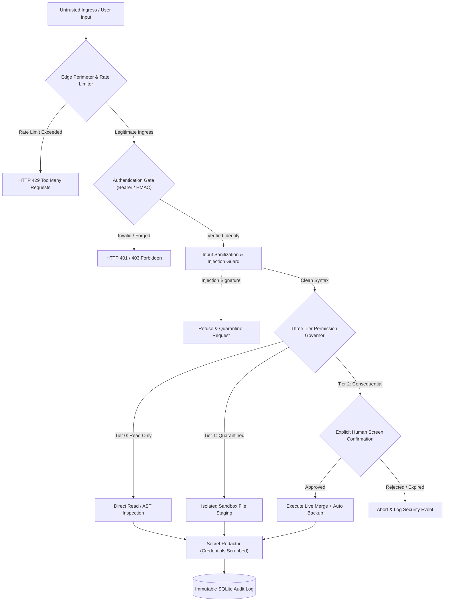

# Security Fundamentals: CIA Triad, Threat Modeling, and Defense in Depth

## 1. Overview

Security fundamentals provide the theoretical and practical bedrock upon which all reliable software systems are built. In autonomous AI engineering, cloud backends, and personal assistant architectures, security cannot be treated as a perimeter afterthought; it must be designed into every interface, data structure, and process boundary.

This document synthesizes core cybersecurity principles—specifically the **CIA Triad (Confidentiality, Integrity, Availability)**, **STRIDE Threat Modeling**, and **Defense-in-Depth Architecture**—and demonstrates how they are practically realized in real-world systems like **SHIVAY** and **JARVIS**.

---

## 2. Problem Statement

Modern software systems face an asymmetric threat landscape:
- Developers must secure every attack surface, whereas an adversary only needs to find one unvalidated input, misconfigured permission, or unpatched dependency.
- AI systems introduce non-deterministic execution pathways: when language models generate code or call system tools, traditional perimeter security fails if the internal agent has unrestricted operating system privileges.
- Distributed personal data (voice streams, financial records, authentication tokens) risks exposure if confidentiality and integrity are not cryptographically enforced at rest and in transit.

---

## 3. Security Objectives

1. **Enforce Confidentiality:** Prevent unauthorized disclosure of user credentials, private keys, voice telemetry, and database records using strong encryption (AES-256-GCM, TLS 1.3) and automated data scrubbing.
2. **Guarantee Data & System Integrity:** Ensure that software code, state transitions, API payloads, and webhook events cannot be modified in transit without detection (via HMAC-SHA256 and immutable audit trails).
3. **Preserve System Availability:** Guard endpoints against denial-of-service, runaway subprocess loops, and resource exhaustion using rate limiters, PID locks, and fail-safe circuit breakers.
4. **Principle of Least Privilege (PoLP):** Restrict agents, services, and tokens strictly to the minimum capabilities necessary to complete their task.

---

## 4. Architecture & Threat Modeling Workflow

The architecture applies the **STRIDE** model (Spoofing, Tampering, Repudiation, Information Disclosure, Denial of Service, Elevation of Privilege) at each layer:



---

## 5. Technical Explanation & Principles

### A. The CIA Triad in Autonomous AI Systems
- **Confidentiality:** Handled via token authorization, AES-256-GCM credential encryption, and `SecretRedactor` stripping API keys (`sk-...`, `AIza...`) and phone numbers before writing to logs.
- **Integrity:** Enforced by constant-time cryptographic verification (`hmac.compare_digest`), raw wire-byte webhook verification, and read-only file sandboxing.
- **Availability:** Preserved through global emergency freeze mechanisms (`emergency_pause = True`), process timeouts (5.0s–20.0s), and token-bucket rate limiters.

### B. STRIDE Mapping to Implemented Controls

| STRIDE Threat Category | Realized Threat Scenario | Implemented Defense Mechanism |
| :--- | :--- | :--- |
| **Spoofing** | Attacker calls telephony endpoints pretending to be the owner | Anti-acoustic verbal authorization block; caller ID verification; WebRTC ephemeral JWTs. |
| **Tampering** | Man-in-the-middle modifies webhook payload amount | Raw-body HMAC-SHA256 signature verification matching gateway digest. |
| **Repudiation** | Operator denies initiating consequential system scan | Immutable SQLite audit logs recording actor, IP, timestamp, and signed approval tokens. |
| **Information Disclosure** | API token or credentials leaked in exception stack trace | `SensitiveDataFilter` and `SecretRedactor` intercepting all console and file log streams. |
| **Denial of Service** | Rapid repeated requests exhaust server thread pool | RemotePerimeterMiddleware enforcing 60 requests/min and 15-minute IP freezes after auth failures. |
| **Elevation of Privilege** | AI agent escalates from read-only query to live file write | Strict 3-tier boundary governor; Tier 2 operations hard-gated by screen confirmation. |

---

## 6. Implementation Details

Verified implementation from `src/shivai/security/scope_guard.py` demonstrating strict boundary validation:

```python
import re
from typing import Set

class TargetScopeGuard:
    """Enforces syntactic validation and blocks unauthorized shell injection metacharacters."""

    # Disallow all command chaining, piping, and shell expansion symbols
    FORBIDDEN_METACHARS: Set[str] = {
        ";", "&", "|", "`", "$", "<", ">", "!", "\\",
        '"', "'", "(", ")", "[", "]", "{", "}", "\r", "\n", "\x00"
    }

    @classmethod
    def sanitize_input(cls, user_text: str) -> str:
        clean = user_text.strip()
        for char in cls.FORBIDDEN_METACHARS:
            if char in clean:
                raise ValueError(f"Input rejected: Disallowed security character '{char}' detected.")
        return clean
```

---

## 7. Relevant Source File References

- `src/shivai/security/scope_guard.py`: Syntactic boundary validation and injection character rejection.
- `src/shivai/security/auth.py`: Constant-time token verification and emergency pause middleware.
- `src/shivai/security/secret_redactor.py`: Recursive credential and token scrubbing engine.
- `src/shivai/security/process_guard.py`: Single-instance PID locking and process supervision.

---

## 8. Testing Methodology & Verification Evidence

### Methodology
1. **Automated Unit Testing:** Submit malicious input containing forbidden shell metacharacters (`localhost; rm -rf /`) to verify immediate rejection.
2. **Timing Attack Simulation:** Verify that invalid authentication tokens fail in constant time regardless of character match position.
3. **Emergency Halt Validation:** Trigger `emergency_pause = True` and verify that all state-modifying endpoints immediately return HTTP 503.

### Evidence
- **Status:** **`[TESTED]`**
- **Test File:** `tests/test_phase9_integration_and_reliability.py`
- **Result:** PASSED. Metacharacter injection attempts were successfully intercepted by `TargetScopeGuard` with zero subprocess execution.

---

## 9. Limitations & Known Issues

- **Heuristic Metacharacter Filtering:** Denylisting specific characters is an effective first line of defense, but defense-in-depth requires strictly parameterizing commands with `shell=False` rather than relying solely on character sanitization.
- **Single-Host PID Locks:** File-based PID locking (`acquire_pid_lock`) is effective on local macOS/Linux workstations, but does not provide distributed locking in multi-server container clusters.

---

## 10. Security Recommendations

1. **Adopt Whitelisting Over Denylisting:** Where feasible, enforce strict alphanumeric regular expressions (`^[a-zA-Z0-9_\-\.]+$`) rather than stripping forbidden characters.
2. **Combine Layered Controls:** Always couple input validation with sandboxed execution environments and unprivileged OS user accounts.
3. **Implement Automated Dependency Scanning:** Continuously run `pip-audit` or `safety` in CI/CD pipelines to catch vulnerable upstream packages before release.

---

## 11. References

- NIST Special Publication 800-53: *Security and Privacy Controls for Information Systems and Organizations*.
- OWASP Foundation: *Threat Modeling Cheat Sheet*.
- Saltzer, J. H., & Schroeder, M. D. (1975): *The Protection of Information in Computer Systems*.
