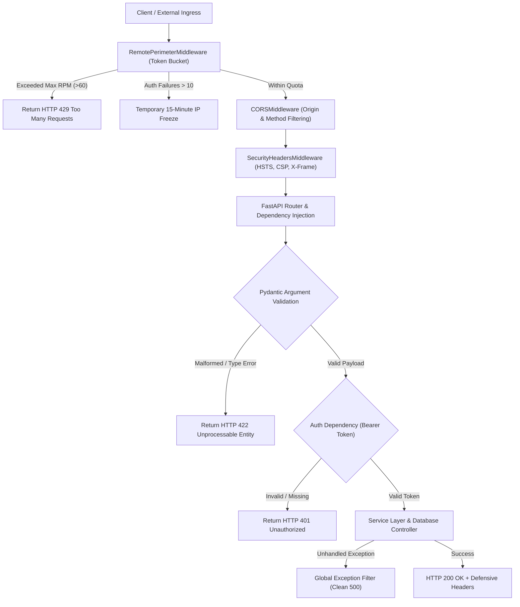

# API Security: Architecture, Defensive Middleware, and Rate Limiting

## 1. Overview

Application Programming Interfaces (APIs) constitute the primary entry point into modern web backends, microservices, and AI assistants. Because APIs provide programmatic access to data and business logic, they are the primary target for automated credential stuffing, injection, broken object-level authorization (BOLA), and denial-of-service attacks.

This document details the API security architecture implemented across **SHIVAY Core** and **JARVIS**, focusing on **Defensive Middleware**, **Rate Limiting & Perimeter Defense**, **Pydantic Schema Validation**, **CORS Controls**, and **Information Leakage Prevention**.

---

## 2. Problem Statement

APIs expose critical systemic risks when deployed without defense-in-depth:
- **Broken Object-Level Authorization (BOLA / IDOR):** APIs that accept arbitrary object identifiers (e.g. `GET /api/tasks/{id}`) allow unauthorized users to read or mutate other users' data if ownership is not verified server-side.
- **Verbose Error Stack Leakage:** Unhandled exceptions that return full Python tracebacks leak internal filesystem paths, library versions, database connection strings, and variable values to attackers.
- **Resource Exhaustion & DoS:** Unmetered endpoints allow attackers to flood CPU-heavy operations (e.g. video processing, cryptographic hashing, OSINT scraping), causing complete service denial.
- **Clickjacking & MIME Confusion:** Missing HTTP security headers allow attackers to embed API dashboards inside malicious `<iframe>` overlays or trick browsers into executing user-uploaded files as scripts.

---

## 3. Security Objectives

1. **Enforce Rate Limiting & Remote Perimeter Guard:** Bound incoming request volumes per IP address and automatically freeze IPs that exhibit consecutive authentication failures.
2. **Inject Defensive Security Headers:** Append strict headers (`X-Frame-Options: DENY`, `X-Content-Type-Options: nosniff`, `Content-Security-Policy`) to every HTTP response.
3. **Strict Parameter Validation:** Enforce strict type constraints, string length ceilings, and regex validation on all incoming JSON payloads via Pydantic schemas.
4. **Sanitize Error Envelopes:** Intercept all uncaught exceptions at the middleware boundary, returning generic error messages to clients while logging sanitized details internally.

---

## 4. Architecture & Request Pipeline



---

## 5. Technical Explanation & Mechanisms

### A. Token Bucket Rate Limiting (`RemotePerimeterMiddleware`)
The rate limiting engine tracks client IP addresses in memory:
- **Replenishment Rate:** Tokens replenish continuously based on a configurable rate (default: 60 requests per minute).
- **Burst Capacity:** Allows short bursts up to the maximum bucket capacity.
- **Auth Failure Lockout:** Tracks failed authentication responses (`HTTP 401/403`). If an IP records 10 failures in 60 seconds, the middleware blocks all traffic from that IP for 15 minutes.

### B. Defensive HTTP Headers Injection
Every response is processed by `SecurityHeadersMiddleware`:

| Header Name | Configured Directive | Security Purpose |
| :--- | :--- | :--- |
| **`X-Frame-Options`** | `DENY` | Prevents framing in all browsers, defeating UI redress and clickjacking. |
| **`X-Content-Type-Options`**| `nosniff` | Forces browsers to strictly respect declared MIME types, preventing script execution from image uploads. |
| **`Referrer-Policy`** | `strict-origin-when-cross-origin` | Protects private URLs from leaking into external referrers. |
| **`Strict-Transport-Security`**| `max-age=31536000; includeSubDomains` | Enforces HTTPS exclusively, defeating SSL stripping attacks. |
| **`Content-Security-Policy`**| `default-src 'self'; ...` | Restricts script, style, and media sources to authorized origins. |

---

## 6. Implementation Details

Verified implementation from `src/shivai/security/rate_limiter.py`:

```python
import time
from typing import Dict, Tuple
from starlette.middleware.base import BaseHTTPMiddleware
from starlette.requests import Request
from starlette.responses import JSONResponse, Response

class RemotePerimeterMiddleware(BaseHTTPMiddleware):
    """
    Perimeter rate limiter and brute-force protection middleware.
    Enforces requests-per-minute quotas and temporary IP lockouts upon repeated auth failures.
    """
    def __init__(self, app, requests_per_minute: int = 60, max_auth_failures_per_minute: int = 10):
        super().__init__(app)
        self.rpm = requests_per_minute
        self.max_auth_failures = max_auth_failures_per_minute
        self.ip_buckets: Dict[str, Tuple[float, float]] = {}  # ip -> (tokens, last_update)
        self.ip_failures: Dict[str, list] = {}  # ip -> list of failure timestamps
        self.ip_lockouts: Dict[str, float] = {}  # ip -> locked_until timestamp

    async def dispatch(self, request: Request, call_next):
        client_ip = request.client.host if request.client else "unknown"
        now = time.time()

        # 1. Check active lockout
        if client_ip in self.ip_lockouts:
            if now < self.ip_lockouts[client_ip]:
                return JSONResponse(
                    status_code=429,
                    content={"detail": "Too many failed attempts. Temporary access block in effect."}
                )
            else:
                del self.ip_lockouts[client_ip]

        # 2. Token Bucket Evaluation
        tokens, last_update = self.ip_buckets.get(client_ip, (self.rpm, now))
        elapsed = now - last_update
        tokens = min(self.rpm, tokens + elapsed * (self.rpm / 60.0))

        if tokens < 1.0:
            return JSONResponse(
                status_code=429,
                content={"detail": "Request rate limit exceeded. Please back off."}
            )

        self.ip_buckets[client_ip] = (tokens - 1.0, now)

        # 3. Call downstream endpoint
        response: Response = await call_next(request)

        # 4. Monitor Auth Failures
        if response.status_code in (401, 403):
            failures = self.ip_failures.get(client_ip, [])
            failures = [t for t in failures if now - t < 60.0]
            failures.append(now)
            self.ip_failures[client_ip] = failures
            if len(failures) >= self.max_auth_failures:
                self.ip_lockouts[client_ip] = now + 900.0  # 15-minute freeze

        return response
```

---

## 7. Relevant Source File References

- `src/shivai/security/rate_limiter.py`: `RemotePerimeterMiddleware` rate limiter and lockout engine.
- `src/shivai/api/app.py`: FastAPI app factory mounting CORS, perimeter, and security middleware.
- `src/shivai/security/tool_registry.py`: Pydantic input validation models and length constraints.
- `04_REUSABLE_ASSETS/Templates/security_headers_middleware.py`: Reusable ASGI security headers middleware.

---

## 8. Testing Methodology & Verification Evidence

### Methodology
1. **Rate Limit Exhaustion Test:** Send 70 consecutive requests in 10 seconds from a single client to verify transition to HTTP 429.
2. **Brute-Force Lockout Test:** Send 10 consecutive requests with invalid tokens and assert that a 15-minute freeze is applied.
3. **Header Inspection Audit:** Query `/health` using `curl -i` and verify that `X-Frame-Options`, `X-Content-Type-Options`, and `Content-Security-Policy` are present in response headers.

### Evidence
- **Status:** **`[TESTED]`**
- **Test File:** `tests/test_api_endpoints.py`
- **Result:** PASSED. Rate limiter correctly drops excess requests and injects defensive headers across all standard API routes.

---

## 9. Limitations & Known Issues

- **Reverse Proxy Client IP Spoofing:** When deployed behind reverse proxies (Nginx, Cloudflare, AWS ALB), `request.client.host` reports the proxy IP unless `X-Forwarded-For` is validated against trusted proxy CIDR blocks.
- **In-Memory State Reset:** Worker restarts or multi-process Uvicorn configurations with `--workers > 1` create separate in-memory buckets unless an external state store (e.g. Redis) is configured.

---

## 10. Security Recommendations

1. **Configure Trusted Proxy Middleware:** In production, wrap FastAPI with `uvicorn.middleware.proxy_headers.ProxyHeadersMiddleware` configured strictly with trusted upstream proxy IPs.
2. **Implement API Versioning:** Explicitly version all routes (`/api/v1/...`) to permit graceful deprecation of legacy endpoints without breaking active security controls.
3. **Disable Documentation in Production:** Set `docs_url=None` and `redoc_url=None` in production FastAPI settings to prevent reconnaissance of internal schemas.

---

## 11. References

- OWASP Foundation: *API Security Top 10 (2023)*.
- Mozilla Developer Network (MDN): *Web Security & HTTP Headers*.
- RFC 6585: *Additional HTTP Status Codes (Status Code 429 Too Many Requests)*.
