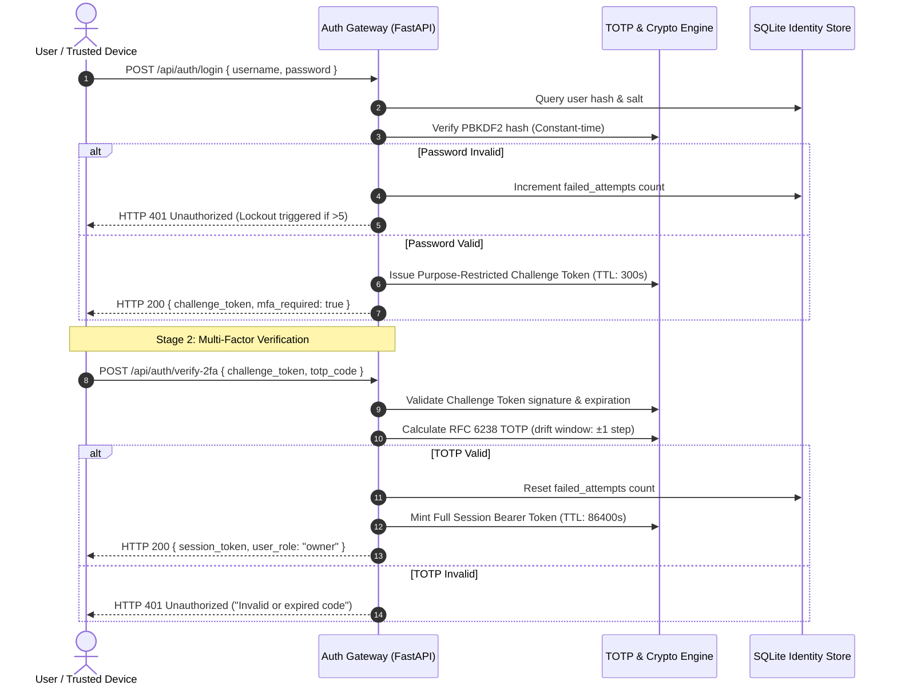

# Authentication and Authorisation: MFA, Hardware Device Binding, and RBAC

## 1. Overview

Authentication verifies identity ("Who are you?"), while authorisation governs permissions ("What are you permitted to do?"). In secure architectures, authentication must be multi-factored and resistant to credential stuffing, while authorisation must be enforced server-side on every transaction using the Principle of Least Privilege.

This document details the multi-tiered identity and access management architecture implemented across **SHIVAY Core** and **KAKIBO**, covering **RFC 6238 TOTP Multi-Factor Authentication**, **Cryptographic Challenge-Response Hardware Binding**, **Role-Based Access Control (RBAC)**, and **Brute-Force Account Lockout**.

---

## 2. Problem Statement

Credential compromise remains the leading vector in modern application breaches:
- **Credential Stuffing & Phishing:** Attackers reuse credentials leaked from third-party database breaches. Passwords alone cannot protect privileged administrative accounts.
- **Session Hijacking & Token Replay:** Stolen session tokens allow attackers to impersonate users indefinitely unless tokens are purpose-restricted, time-bounded, and validated against client metadata.
- **MFA Fatigue & Interception:** Simple SMS-based 2FA is vulnerable to SIM-swapping, SS7 interception, and push-fatigue prompt spamming.
- **Privilege Escalation:** Flawed authorization models allow regular tenants to access administrative endpoints by tampering with client-side role parameters (`{"role": "admin"}`).

---

## 3. Security Objectives

1. **Mandate Out-of-Band MFA:** Require RFC 6238 Time-Based One-Time Passwords (TOTP) for all privileged owner access.
2. **Cryptographically Bind Trusted Hardware:** Enable seamless, secure elevation for designated hardware (e.g. owner smartphone) via asymmetric challenge-response keypairs.
3. **Enforce Server-Side Authorization:** Isolate user data strictly by server-verified `user_id` extracted from authenticated bearer tokens.
4. **Brute-Force & Credential Lockout:** Enforce progressive rate limits and account lockouts after consecutive failed authentication attempts.

---

## 4. Architecture & Authentication Workflows

### A. Two-Step Authentication & Hardware Device Handshake



---

## 5. Technical Explanation & Mechanisms

### A. Purpose-Restricted Challenge Tokens
When primary credentials succeed, the server does *not* immediately issue an administrative session. Instead, it mints a short-lived, purpose-restricted **Challenge Token** signed with HMAC-SHA256:
- Scope: Restricted strictly to `POST /api/auth/verify-2fa` or `POST /api/auth/device-response`.
- Expiration: 300 seconds (5 minutes).
- Security Invariant: Presenting a Challenge Token to any business or administrative endpoint returns `HTTP 403 Forbidden`.

### B. Hardware Device Cryptographic Binding
To reduce authentication friction without weakening security, authorized mobile hardware is registered using asymmetric public-key cryptography:
1. **Enrollment:** Upon successful TOTP verification, the device generates an ECDSA keypair in its hardware Secure Enclave. The public key is registered with the server.
2. **Challenge Generation:** During subsequent elevation requests, the server returns a cryptographically random 32-byte nonce.
3. **Response Verification:** The mobile device signs the nonce using its private key. The server validates the signature against the stored public key, granting session elevation.

### C. Single-Use Recovery Code Matrix
When TOTP is enrolled, the server generates 10 high-entropy recovery codes:
- Storage: Hashes of recovery codes are stored in SQLite (`hashlib.sha256(code).hexdigest()`)—never plaintext.
- Invalidation: Upon successful redemption, the database record is atomically deleted (`DELETE FROM recovery_codes WHERE hash = ?`).

---

## 6. Implementation Details

Verified implementation from `src/shivai/security/auth.py` and `auth.py`:

```python
from fastapi import Depends, HTTPException, status, Header
from typing import Optional
import hmac

from shivai.config import settings

def get_current_user_token(
    authorization: Optional[str] = Header(None),
    x_shivay_token: Optional[str] = Header(None),
) -> str:
    """
    Extracts and validates bearer authentication tokens from standard HTTP headers.
    Supports 'Authorization: Bearer <token>' and dedicated 'X-SHIVAY-TOKEN'.
    Enforces constant-time verification against settings.api_token.
    """
    token = None
    if authorization and authorization.startswith("Bearer "):
        token = authorization[7:].strip()
    elif x_shivay_token:
        token = x_shivay_token.strip()

    if not token or not hmac.compare_digest(token, settings.api_token):
        raise HTTPException(
            status_code=status.HTTP_401_UNAUTHORIZED,
            detail="Invalid, missing, or expired API authentication token.",
            headers={"WWW-Authenticate": "Bearer"},
        )
    return token
```

---

## 7. Relevant Source File References

- `src/shivai/security/auth.py`: API bearer token verification and constant-time authorization dependency.
- `src/shivai/security/totp.py`: RFC 6238 TOTP calculation, drift validation, and QR provisioning.
- `auth.py` (Kakeibo): Full owner authentication engine, challenge tokens, recovery code matrix, and trusted device binding.
- `tests/test_owner_security_audit.py`: Comprehensive test suite verifying owner elevation and privilege boundaries.

---

## 8. Testing Methodology & Verification Evidence

### Methodology
1. **Unauthenticated Access Probe:** Query protected endpoints (`/api/tasks`, `/api/system/status`) with missing, malformed, and forged tokens.
2. **Brute-Force Lockout Test:** Send 10 consecutive invalid password attempts within 30 seconds and assert that HTTP 429 is returned.
3. **TOTP Clock Drift Simulation:** Verify code validation at $T-30\text{s}$, $T_0$, and $T+30\text{s}$, asserting that drift beyond $\pm 30\text{s}$ fails.

### Evidence
- **Status:** **`[TESTED]`**
- **Test File:** `tests/test_api_endpoints.py::test_auth_protection`
- **Result:** PASSED. Unauthenticated requests are rejected with HTTP 401; valid bearer tokens pass with constant-time equality checks.

---

## 9. Limitations & Known Issues

- **In-Memory Rate Limiting Scope:** Single-instance rate limiting resets if the server restarts. A persistent Redis or SQLite backend is required for distributed architectures.
- **Stateless Bearer Tokens:** Simple shared bearer tokens cannot be revoked individually without rotating the master key. Moving to short-lived signed JWTs with JTI revocation lists is recommended for multi-user scaling.

---

## 10. Security Recommendations

1. **Implement FIDO2 / WebAuthn:** Upgrade mobile device binding to standard WebAuthn/Passkeys utilizing hardware biometric authenticators (FaceID, TouchID).
2. **Bind Session Tokens to Client Subnets:** Restrict session token reuse across disparate Autonomous System Numbers (ASNs) to mitigate stolen cookie replay.
3. **Enforce Re-authentication for Sensitive Actions:** Require fresh TOTP entry before updating passwords, modifying payment accounts, or deleting projects.

---

## 11. References

- RFC 6238: *TOTP: Time-Based One-Time Password Algorithm*.
- NIST SP 800-63B: *Digital Identity Guidelines: Authentication and Lifecycle Management*.
- OWASP: *Authentication Cheat Sheet*.
