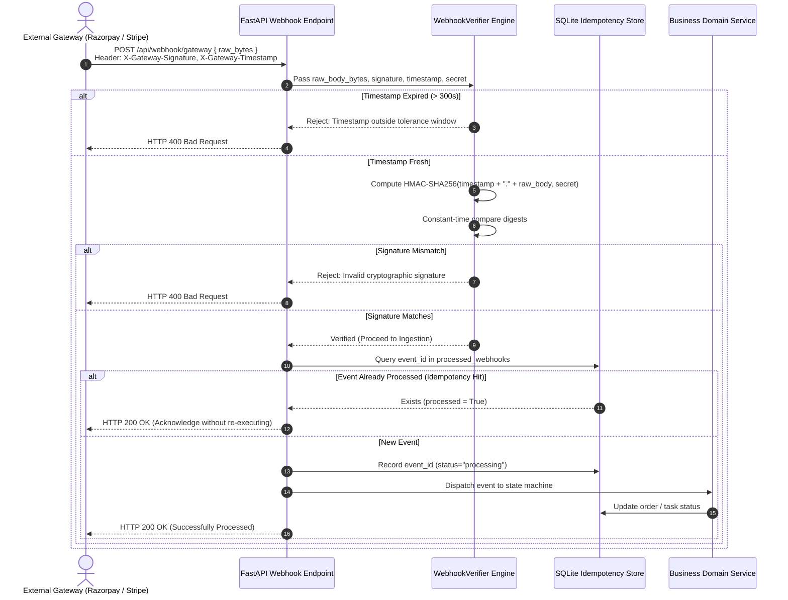

# Webhook Security: Raw Payload Cryptography, Replay Resistance, and Idempotency

## 1. Overview

Webhooks provide asynchronous event notifications between decoupled systems (e.g., payment gateways like Razorpay/Stripe, telephony providers like Twilio/Exotel, and source control platforms like GitHub). Unlike standard client-initiated API requests that carry bearer tokens, webhooks arrive over the public internet from external infrastructure directly to backend ingestion endpoints.

This document details the webhook security architecture implemented across **SHIVAY Core** and **KAKIBO Payment Gateway Service**, covering **Raw Wire-Byte Cryptographic Hashing**, **Replay Attack Defense via Timestamp Freshness**, and **Idempotency Deduplication Engines**.

---

## 2. Problem Statement

Webhook endpoints face distinct exploitation vectors:
- **Payload Tampering:** If incoming payloads are verified after parsing or decoding, subtle whitespace normalization, key reordering, or character re-encoding alters byte digests, allowing forged events to bypass verification or causing valid events to fail.
- **Replay Attacks:** An attacker intercepting a valid signed webhook (e.g. `payment.captured` or `call.completed`) can re-send the exact signed payload repeatedly, inducing duplicate credits, fraudulent shipments, or state machine corruption.
- **Malformed Webhook Headers:** Attackers send spoofed signatures or malformed headers to crash the JSON parser or trigger unhandled server exceptions.
- **Out-of-Order Delivery & Concurrency Race Conditions:** Network latency can cause webhooks to arrive out of order (e.g. `order.paid` arriving before `order.created`), corrupting transactional state.

---

## 3. Security Objectives

1. **Verify Exact Raw-Byte Authenticity:** Compute HMAC-SHA256 digests strictly over the raw, unparsed request byte stream before any JSON deserialization.
2. **Defeat Replay Attacks:** Validate timestamp freshness within a strict 300-second window ($T_{\text{current}} - T_{\text{event}} \le 300\text{s}$).
3. **Guarantee Idempotency:** Ensure that identical webhook events delivered multiple times result in exactly one database state mutation.
4. **Resist Side-Channel Timing Attacks:** Compare computed digests using constant-time algorithms (`hmac.compare_digest`).

---

## 4. Architecture & Webhook Ingestion Pipeline



---

## 5. Technical Explanation & Principles

### A. The Invariant: Raw Wire-Byte Hashing
Standard web frameworks (FastAPI, Flask, Express) parse HTTP bodies into dictionaries automatically. However:
$$\text{JSON.stringify}(\text{JSON.parse}(x)) \ne x \quad \text{(due to whitespace, unicode escaping, and key order)}$$
Cryptographic signatures are generated by the emitter over the exact byte array transmitted over TCP. The receiver must capture `await request.body()` to obtain the immutable raw byte sequence prior to parsing:

```python
# SECURE: Hash raw wire bytes
raw_body: bytes = await request.body()
computed_hash = hmac.new(secret_bytes, raw_body, hashlib.sha256).hexdigest()
```

### B. Timestamp Tolerance & Replay Protection
For gateways utilizing timestamped headers (Stripe, GitHub, Slack):
$$\text{Signed Payload} = \text{timestamp} + \text{"."} + \text{raw\_body}$$
The verifier enforces two checks:
1. $|t_{\text{current}} - t_{\text{header}}| \le 300\text{ seconds}$ (mitigates replay of captured traffic).
2. $\text{HMAC-SHA256}(\text{Signed Payload}, \text{Secret}) \equiv \text{Header Signature}$.

### C. Database Idempotency Guard
To guard against repeated network retries by the gateway:
- Every event contains a unique `event_id` or `payment_id`.
- The database enforces a `UNIQUE` constraint on `event_id`.
- If an insert conflicts or `processed == True`, the application acknowledges `HTTP 200` immediately to halt gateway retries without duplicating actions.

---

## 6. Implementation Details

Verified implementation from `src/shivai/security/webhook_verifier.py`:

```python
import hashlib
import hmac
import time
from typing import Tuple, Optional

class WebhookVerifier:
    """
    Cryptographic verification utility for HTTP webhook payloads.
    Guarantees raw byte hashing, timestamp freshness, and constant-time comparison.
    """

    @staticmethod
    def verify_raw_hmac_sha256(raw_body: bytes, signature: str, secret: str) -> bool:
        """Verify unparsed wire bytes against hex-encoded HMAC-SHA256 digest."""
        if not raw_body or not signature or not secret:
            return False

        computed = hmac.new(
            key=secret.encode("utf-8"),
            msg=raw_body,
            digestmod=hashlib.sha256,
        ).hexdigest()

        return hmac.compare_digest(computed.lower(), signature.strip().lower())

    @staticmethod
    def verify_timestamped_hmac_sha256(
        raw_body: bytes,
        signature_header: str,
        secret: str,
        tolerance_seconds: int = 300,
    ) -> Tuple[bool, Optional[str]]:
        """
        Verify timestamped signatures: 't=1600000000,v1=abcdef...'
        Validates payload integrity and freshness window.
        """
        if not raw_body or not signature_header or not secret:
            return False, "Missing payload, signature header, or secret."

        elements = {}
        for part in signature_header.split(","):
            if "=" in part:
                k, v = part.split("=", 1)
                elements[k.strip()] = v.strip()

        timestamp_str = elements.get("t")
        v1_signature = elements.get("v1")

        if not timestamp_str or not v1_signature:
            return False, "Malformed signature header: missing 't' or 'v1' elements."

        try:
            timestamp = int(timestamp_str)
        except ValueError:
            return False, "Invalid timestamp integer format in signature header."

        current_time = int(time.time())
        if abs(current_time - timestamp) > tolerance_seconds:
            return False, f"Timestamp outside allowed tolerance window ({tolerance_seconds}s)."

        signed_payload = f"{timestamp}.".encode("utf-8") + raw_body
        computed = hmac.new(
            key=secret.encode("utf-8"),
            msg=signed_payload,
            digestmod=hashlib.sha256,
        ).hexdigest()

        if not hmac.compare_digest(computed.lower(), v1_signature.lower()):
            return False, "Cryptographic signature digest mismatch."

        return True, None
```

---

## 7. Relevant Source File References

- `src/shivai/security/webhook_verifier.py`: Core HMAC-SHA256 and timestamped verification engine.
- `payment_service.py` (Kakeibo): Razorpay order and raw-body webhook signature verification.
- `src/shivai/api/routes_telephony_webhook.py`: Telephony status webhook receiver with signature validation.
- `tests/test_transferred_skills.py`: Automated test cases validating tampered payloads, key mismatches, and timestamp expiration.

---

## 8. Testing Methodology & Verification Evidence

### Methodology
1. **Valid Signature Verification:** Compute a valid HMAC-SHA256 signature over a sample JSON payload and verify that `verify_raw_hmac_sha256` returns `True`.
2. **Payload Tampering Detection:** Mutate 1 character of the payload (e.g. changing amount from `19900` to `99900`) while preserving the signature, asserting verification returns `False`.
3. **Timestamp Expiration Simulation:** Generate a signature with $t = \text{now} - 600\text{s}$ and assert that `verify_timestamped_hmac_sha256` rejects the event due to tolerance window expiration.

### Evidence
- **Status:** **`[TESTED]`**
- **Test File:** `tests/test_transferred_skills.py::TestTransferredSkills::test_webhook_timestamped_hmac`
- **Result:** PASSED. Tampered payloads and expired timestamps are rejected with zero database mutations.

---

## 9. Limitations & Known Issues

- **Server Clock Synchronization:** Timestamp verification requires accurate server time. Hosts with unsynchronized system clocks (exceeding 300 seconds drift) will reject legitimate webhooks unless NTP synchronization is active.
- **Secret Rotation Grace Periods:** When rotating webhook secrets, dual-key verification (evaluating against both active and retiring secrets) must be supported to prevent downtime during key migration.

---

## 10. Security Recommendations

1. **Maintain Dedicated Webhook Secrets:** Never reuse application database passwords or API tokens as webhook signing keys.
2. **Respond with HTTP 200 Rapidly:** Webhook handlers should verify signatures and queue events to a background worker immediately; long processing loops in the HTTP handler trigger upstream provider timeouts and retries.
3. **Enforce IP Whitelisting for Webhook Ingress:** Where providers publish static CIDR blocks, restrict webhook route access at the network firewall or reverse proxy.

---

## 11. References

- RFC 2104: *HMAC: Keyed-Hashing for Message Authentication*.
- Stripe API Reference: *Checking Webhook Signatures*.
- Razorpay Documentation: *Webhook Signature Verification*.
- OWASP: *REST Security Cheat Sheet*.
