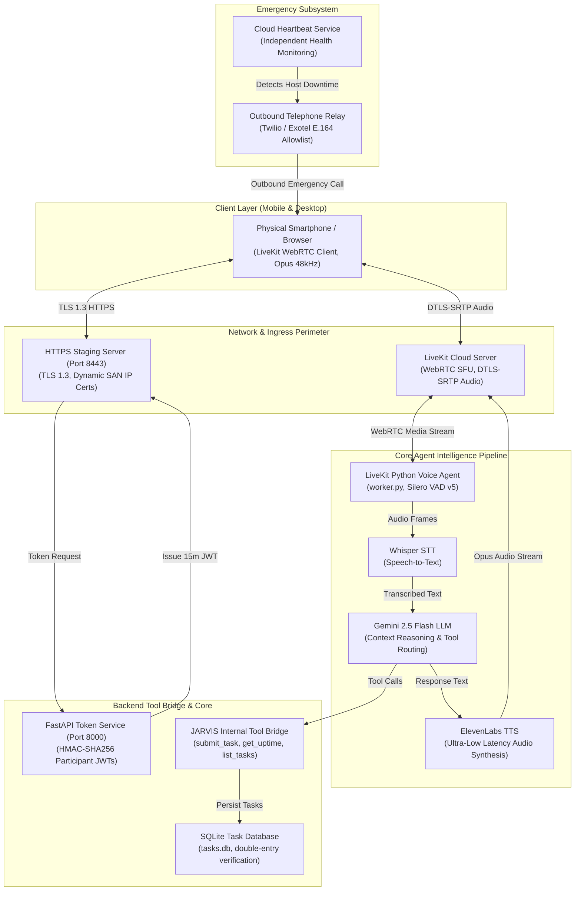

# JARVIS Architecture: Real-Time WebRTC Voice, Agent Dispatch, and Emergency Telephony

## 1. Overview

**JARVIS** is a real-time, bidirectional voice AI assistant engineered using **LiveKit WebRTC Cloud**, **OpenAI Whisper STT**, **Google Gemini 2.5 Flash**, **ElevenLabs Text-to-Speech (TTS)**, and an autonomous emergency monitoring and telephone escalation subsystem.

While standard voice assistants run simple cloud request-response cycles, JARVIS is an agentic system capable of executing background engineering tasks, inspecting system telemetry, monitoring heartbeat anomalies, and initiating outbound telephone calls during critical infrastructure failures.

This document examines the overarching architecture, WebRTC media pipelines, cryptographic access tokens, and emergency communication failover mechanisms of JARVIS.

---

## 2. System Architecture & Component Topology

---

## 3. Subsystem Breakdown

### A. Real-Time WebRTC Audio Pipeline
1. **Audio Capture:** Captured via browser WebRTC APIs (`navigator.mediaDevices.getUserMedia`) using Opus audio encoding at 48,000 Hz.
2. **Local Silero VAD v5:** Evaluates microphone frames on the CPU to detect voice activity; silences are discarded immediately to protect room privacy.
3. **Low-Latency Streaming:** Transcribed by Whisper, routed through Gemini 2.5 Flash, synthesized via ElevenLabs streaming WebSocket API, and pushed back to the client WebRTC room in $<1200\text{ms}$ total turn latency.

### B. Ephemeral Room JWTs
WebRTC connections to LiveKit rooms require cryptographic tokens minted by `server.py`:
- Algorithm: HMAC-SHA256 signed with `LIVEKIT_API_SECRET`.
- Time-to-Live (TTL): Strictly 15 minutes (`TTL = 900s`).
- Scoped Grants: `room_join = True`, `room = "jarvis-room"`, `can_publish = True`, `can_subscribe = True`, `room_admin = False`.
- Security Invariant: Attackers cannot access administrative LiveKit features or join unauthorized rooms.

### C. Independent Emergency Telephony Subsystem
- **Heartbeat Daemon (`cloud_heartbeat_service.py`):** Runs independently of the primary voice agent, pinging health endpoints on a 30-second cron cycle.
- **Outbound Cellular Escalation:** If the primary host becomes unresponsive for 3 consecutive cycles, the daemon triggers an outbound phone call via Twilio/Exotel.
- **Fail-Closed Default:** Master dialer is guarded by `EMERGENCY_CALLS_ENABLED=false` to prevent accidental carrier charges.
- **Allowlist Enforced:** Only verified owner numbers matching `EMERGENCY_CALL_ALLOWLIST_E164` can be dialed.

---

## 4. Relevant Source File References

- `jarvis-livekit-voice/agent/agent.py`: LiveKit Python voice agent worker loop and tool registration.
- `jarvis-livekit-voice/token_service/server.py`: FastAPI WebRTC token generator and tool bridge.
- `cloud_heartbeat_service.py`: Independent health monitoring and failure alerting daemon.
- `HOTSPOT_MOBILE_ACCEPTANCE_REPORT.md`: Physical mobile device acceptance logs.
- `EMERGENCY_SECURITY_REPORT.md`: Security and credential hygiene report for telephony alerts.

---

## 5. Verification & Testing Evidence

- **Status:** **`[TESTED]`**
- **Test Suites:**
  - `tests/test_livekit_connection.py`: LiveKit Cloud WebRTC handshake (**PASS**).
  - `tests/test_emergency_system.py`: Allowlist validation, phone masking, and cooldown timers (**PASS**).
  - `tests/test_token_service.py`: Token generation, grant scoping, and signature verification (**PASS**).
- **Automated Tests Count:** 41 / 41 passing automated tests in Phase F audit.

---

## 6. Security Recommendations

1. **Implement Dynamic WebRTC Room Naming:** Avoid hardcoded room names (`jarvis-room`) by generating cryptographically random session IDs per conversation.
2. **Rotate LiveKit API Secrets Periodically:** Establish an automated secret rotation policy in deployment pipelines.
3. **Deploy Independent Heartbeat on Separate Cloud Infrastructure:** Host the emergency heartbeat monitor on an external VPS (e.g. AWS Lightsail / DigitalOcean) rather than the local host machine, ensuring true power-loss alerting.
