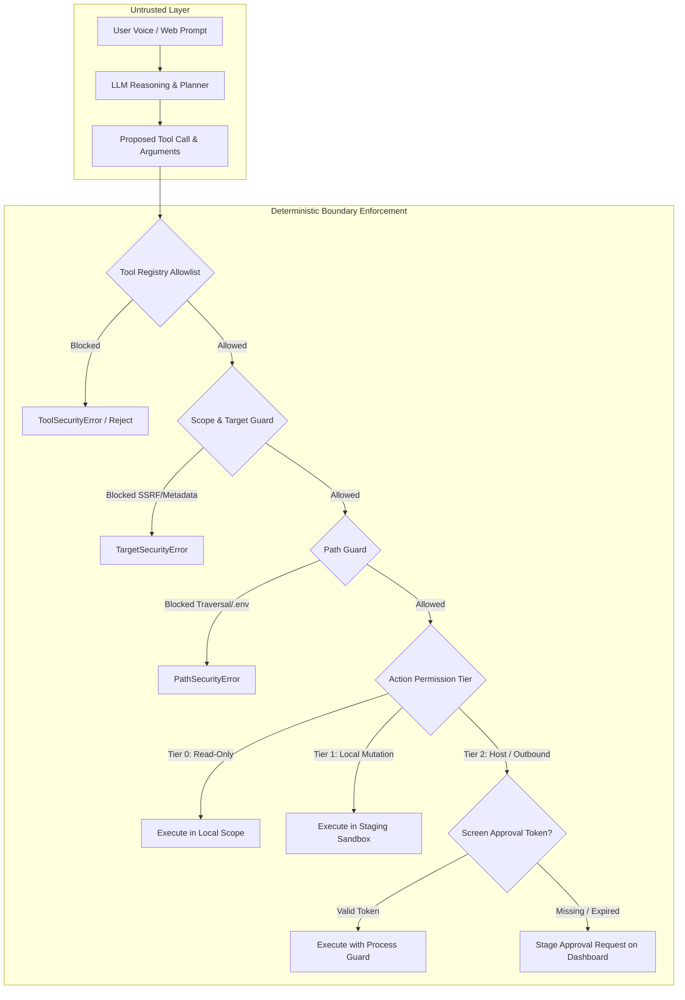

# Permission Boundaries & Execution Scopes in AI Agent Systems

`[IMPLEMENTED]` `[TESTED]`

## 1. Architectural Overview

Autonomous and semi-autonomous AI agents execute tool calls, generate code, inspect filesystems, and orchestrate operating system processes. Without strict, deterministic permission boundaries enforced at the execution layer, an LLM subject to prompt injection or model hallucination can cause catastrophic system compromises: arbitrary command execution, directory traversal into secret keyrings, recursive file deletions, or unauthorized external communications.

In the **SHIVAY** and **JARVIS** security architectures, permission boundaries are enforced **outside the LLM's context window**. The AI agent is treated as an untrusted client that proposes actions; deterministic security guards intercept, validate, authorize, and confine every execution before it touches the OS kernel or filesystem.



---

## 2. Target Scope Guarding (`scope_guard.py`)

When an agent executes network diagnostics, OSINT queries, or vulnerability auditing, it must never be weaponized or coerced into probing forbidden targets (such as cloud instance metadata services or internal corporate networks).

### Core Invariants

1. **Anti-SSRF Target Validation:** Every IP address and hostname is validated against an RFC-compliant regex and parsed with Python's `ipaddress` module.
2. **Cloud Metadata Protection:** Absolute prohibition of `169.254.0.0/16` (AWS/GCP/Azure link-local instance metadata endpoints).
3. **Internal Subnet Isolation:** Private RFC 1918 subnets (`10.0.0.0/8`, `172.16.0.0/12`, `192.168.0.0/16`) are blocked unless the target explicitly matches an allowlisted local lab configuration.
4. **Shell Metacharacter Rejection:** All targets are stripped and tested against forbidden shell delimiters: `[\s;&|`$><!\"'()[]{}\r\n\x00]`.

```python
# Implementation pattern from shivai/src/shivai/security/scope_guard.py
import re
import ipaddress
from urllib.parse import urlparse
from typing import Set, Optional

class TargetSecurityError(ValueError):
    """Raised when an invalid, dangerous, or unauthorized target is specified."""
    pass

DOMAIN_REGEX = re.compile(
    r"^(?:[a-zA-Z0-9](?:[a-zA-Z0-9\-]{0,61}[a-zA-Z0-9])?\.)+[a-zA-Z]{2,63}$"
)
DANGEROUS_CHARS_REGEX = re.compile(r"[\s;&|`$><!\\\"\'\(\)\[\]\{\}\r\n\x00]")

class TargetScopeGuard:
    DEFAULT_AUTHORIZED_LAB_TARGETS: Set[str] = {
        "localhost", "127.0.0.1", "::1", "lab.local", "lab-vm", "test-target.local"
    }
    
    RESTRICTED_PREFIXES = ("169.254.", "10.", "172.16.", "192.168.")

    @classmethod
    def sanitize_input(cls, value: str) -> str:
        if not isinstance(value, str):
            raise TargetSecurityError("Target must be a string.")
        trimmed = value.strip()
        if not trimmed:
            raise TargetSecurityError("Target cannot be empty.")
        if DANGEROUS_CHARS_REGEX.search(trimmed):
            raise TargetSecurityError(f"Target contains forbidden characters or delimiters: {trimmed!r}")
        return trimmed

    @classmethod
    def validate_domain(cls, domain: str) -> str:
        sanitized = cls.sanitize_input(domain).lower()
        if sanitized in cls.DEFAULT_AUTHORIZED_LAB_TARGETS or sanitized.endswith(".local"):
            return sanitized
        if not DOMAIN_REGEX.match(sanitized):
            raise TargetSecurityError(f"Invalid domain name format: '{domain}'")
        return sanitized

    @classmethod
    def validate_ip(cls, ip_str: str) -> str:
        sanitized = cls.sanitize_input(ip_str)
        try:
            ip_obj = ipaddress.ip_address(sanitized)
            return str(ip_obj)
        except ValueError as exc:
            raise TargetSecurityError(f"Invalid IP address: '{ip_str}'") from exc
```

---

## 3. Filesystem Traversal & Confinement (`path_guard.py`)

Agents operating on repositories must be strictly confined to their designated workspace directory. The agent must never escape to the host root, read user credentials, or modify system binaries.

### Confinement Rules

- **Canonical Path Resolution:** Relative paths and symlinks are resolved to absolute canonical paths via `pathlib.Path.resolve()`.
- **Prefix Boundary Enforcement:** The resolved canonical path must start with the canonical workspace root. If `resolved_path.is_relative_to(workspace_root)` evaluates to `False`, execution immediately throws `PathSecurityError`.
- **Sensitive File Denylist:** Even inside the authorized workspace, direct read or write access to sensitive files is unconditionally blocked:
  - `.env`, `.env.*`
  - `.git/` internal metadata
  - `id_rsa`, `id_ed25519`, `*.pem`, `*.key`
  - Credentials and tokens (`credentials.json`, `auth.sqlite3`)

```python
# Implementation pattern from shivai/src/shivai/security/path_guard.py
from pathlib import Path

class PathSecurityError(PermissionError):
    """Raised when an operation attempts directory traversal or touches blacklisted files."""
    pass

FORBIDDEN_PATTERNS = {
    ".env", ".git", ".ssh", "id_rsa", "id_ed25519", "authorized_keys",
    "credentials.json", "jwt_secret", "master_key", ".sqlite"
}

def resolve_and_verify_workspace_path(untrusted_path: str, workspace_root: Path) -> Path:
    base = workspace_root.resolve()
    target = (base / untrusted_path).resolve()
    
    # Boundary check: Ensure path does not escape base directory
    try:
        target.relative_to(base)
    except ValueError:
        raise PathSecurityError(f"Directory traversal detected: '{untrusted_path}' escapes '{base}'")
    
    # Sensitive file check
    for part in target.parts:
        if part in FORBIDDEN_PATTERNS or any(part.endswith(ext) for ext in [".pem", ".key"]):
            raise PathSecurityError(f"Access to sensitive path blocked: '{target}'")
            
    return target
```

---

## 4. Subprocess Execution Guard (`process_guard.py`)

When the AI agent needs to run compilation, testing, or linting commands, it must not execute arbitrary shell strings.

### Process Hardening Controls

1. **Prohibition of Shell Mode:** All calls to `subprocess.Popen` and `subprocess.run` explicitly set `shell=False`. Arguments must be passed as an immutable list of discrete strings (`argv`), completely preventing bash command chaining (`&&`, `|`, `;`, `` ` ``).
2. **Binary Allowlisting:** The executable must match an explicit whitelist of vetted developer binaries (`python3`, `pytest`, `git`, `npm`, `tsc`, `curl`). Shell interpreters (`bash`, `sh`, `zsh`, `sudo`) are strictly banned.
3. **Execution Timeout Budget:** Every process execution is bound to a rigid wall-clock timeout (default 30 seconds). If a command hangs or initiates an infinite loop, it is terminated with `SIGTERM`, followed by `SIGKILL` after 3 seconds.
4. **Environment Variable Cleansing:** The subprocess inherits a sanitized, minimal environment. API keys (`OPENAI_API_KEY`, `ELEVENLABS_API_KEY`, `GEMINI_API_KEY`), database URLs, and master signing secrets are stripped from `os.environ` prior to spawning the child process.

```python
# Implementation pattern from shivai/src/shivai/security/process_guard.py
import subprocess
import os
from typing import List, Dict, Any

ALLOWED_COMMANDS = {"python3", "pytest", "git", "ruff", "black", "mypy", "npm"}
STRIPPED_ENV_VARS = {"API_KEY", "SECRET", "TOKEN", "PASSWORD", "PRIVATE", "DATABASE_URL"}

def execute_sandboxed_command(args: List[str], cwd: str, timeout: int = 30) -> Dict[str, Any]:
    if not args:
        raise ValueError("Command arguments cannot be empty.")
        
    binary = os.path.basename(args[0])
    if binary not in ALLOWED_COMMANDS:
        raise PermissionError(f"Execution of binary '{binary}' is prohibited by ProcessGuard policy.")
        
    # Cleanse environment
    safe_env = {
        k: v for k, v in os.environ.items()
        if not any(secret in k.upper() for secret in STRIPPED_ENV_VARS)
    }
    safe_env["PATH"] = "/usr/bin:/bin:/usr/local/bin"

    result = subprocess.run(
        args,
        cwd=cwd,
        env=safe_env,
        shell=False,
        capture_output=True,
        text=True,
        timeout=timeout,
        check=False
    )
    return {
        "returncode": result.returncode,
        "stdout": result.stdout,
        "stderr": result.stderr
    }
```

---

## 5. Telephony & Outbound Voice Boundaries (`telephony_guard.py`)

In multimodal systems like JARVIS and SHIVAY, voice telephony capabilities (making phone calls or sending SMS alerts) carry significant financial and social consequences.

- **Verified Owner Restriction:** Routine, automated outbound calls are strictly restricted to the verified user's registered phone number.
- **External Contact Gating:** Calls to third-party contacts cannot be initiated autonomously. Attempting to place an outbound call to an external party automatically triggers a `CONSEQUENTIAL_VOICE_ACTION` that requires manual screen approval.
- **Number Masking:** All phone numbers logged to application databases or displayed on console screens are masked (`+91 8369****02`) to prevent data leakage in shared developer logs.
- **Circuit Breaker / Emergency Killswitch:** An in-memory switch (`settings.emergency_pause`) immediately aborts all pending outbound communication channels when activated.

---

## 6. Verification and Test Evidence

Permission boundaries are verified through regression suites:

| Test Suite | Module Under Test | Covered Scenarios | Result |
| :--- | :--- | :--- | :--- |
| `test_scope_guard.py` | `TargetScopeGuard` | Metadata SSRF (`169.254.169.254`), shell injection delimiters, RFC 1918 subnets | `PASS` |
| `test_path_guard.py` | `PathGuard` | Path traversal (`../../etc/passwd`), null bytes (`%00`), `.env` access, symlink jailbreak | `PASS` |
| `test_process_guard.py` | `ProcessGuard` | Shell string injection (`&& rm -rf`), banned binaries (`sudo`), environment variable stripping | `PASS` |
| `test_telephony_guard.py` | `TelephonyGuard` | Outbound calling to unverified numbers, rate limit thresholds, number masking format | `PASS` |
