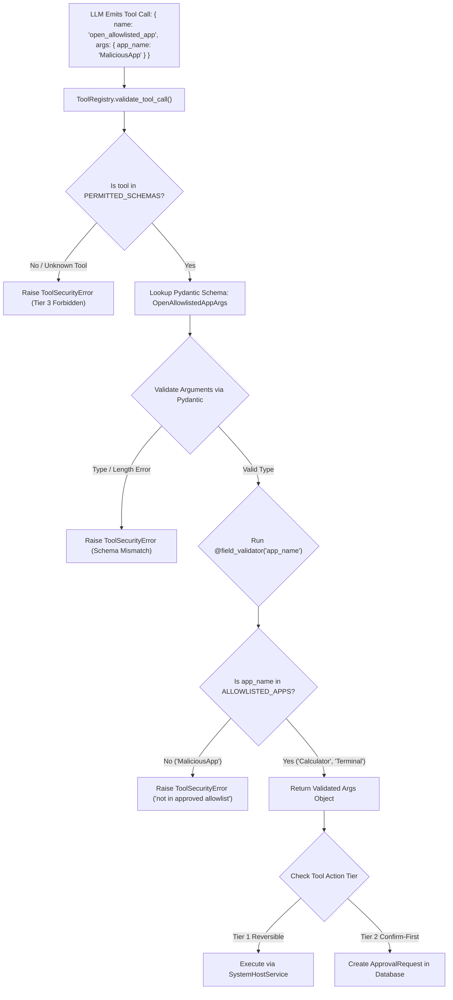

# Tool Allowlisting: Schema Enforcement, Host Tool Gating, and Invariant Verification

## 1. Overview

AI agents achieve operational capability by invoking tools that interface with operating systems, databases, and network services. If an AI agent has access to an open-ended execution tool (e.g. `execute_bash` or `eval`), any prompt injection vulnerability immediately escalates into full system compromise.

This document details the **Tool Allowlisting Architecture** implemented across **SHIVAY Core** and **JARVIS**, explaining how **Pydantic schema validation**, **allowlisted macOS applications**, **approved Shortcuts**, and **non-idempotent tool tracking** restrict agent execution strictly to safe, pre-approved actions.

---

## 2. Problem Statement

Dynamic tool registries in AI systems suffer from three primary vulnerabilities:
- **Arbitrary Application Launching:** If an agent tool accepts any application string (e.g. `open_app(name)`), an attacker can coerce the agent into launching dangerous utilities, custom exploit binaries, or background surveillance processes.
- **Type Coercion & Schema Smuggling:** Tools that accept arbitrary JSON objects or unvalidated keyword arguments allow attackers to smuggle malicious flags or path traversals past un-typed controllers.
- **Accidental Non-Idempotent Tool Re-execution:** In voice dialog or automated retry loops, repeating a non-idempotent tool (such as `dispatch_call` or `create_task`) duplicates phone calls or database records.

---

## 3. Security Objectives

1. **Strict Tool Allowlisting:** Reject any tool call whose name is not registered in `PERMITTED_SCHEMAS`. Unknown tools default to Tier 3 (Forbidden).
2. **Deterministic Schema Validation:** Validate tool arguments strictly using Pydantic models with field constraints (min/max length, regex patterns, enum types).
3. **Host Application Allowlisting:** Restrict macOS application launching strictly to an explicit set of approved productivity and development tools (`ALLOWLISTED_APPS`).
4. **Shortcut Allowlisting:** Restrict macOS Shortcuts execution strictly to user-vetted workflows (`ALLOWLISTED_SHORTCUTS`).

---

## 4. Architecture & Allowlist Validation Engine



---

## 5. Technical Explanation & Allowlist Sets

### A. Approved macOS Applications Allowlist (`ALLOWLISTED_APPS`)
To prevent an agent from launching arbitrary binaries or unauthorized applications, the registry enforces an explicit allowlist:

```python
ALLOWLISTED_APPS: Set[str] = {
    "Terminal", "Visual Studio Code", "Code", "VS Code", "Calculator", "Finder", "Safari",
    "Google Chrome", "Chrome", "Notes", "Calendar", "Reminders", "Spotify", "Music",
    "Xcode", "Slack", "Zoom", "WhatsApp", "Mail", "Photos", "Activity Monitor",
    "System Settings", "Preview", "TextEdit", "UTM", "utm", "iTerm", "iTerm2", "Docker",
}
```
Attempting to launch any application outside this set (e.g. `open_allowlisted_app(app_name="MaliciousApp")`) raises `ToolSecurityError: Application 'MaliciousApp' is not in the approved allowlist`.

### B. Approved macOS Shortcuts Allowlist (`ALLOWLISTED_SHORTCUTS`)
macOS Shortcuts can automate complex desktop actions. The system restricts execution strictly to approved, non-destructive workflows:

```python
ALLOWLISTED_SHORTCUTS: Set[str] = {
    "Daily Briefing",
    "Focus Mode",
    "Mute Audio",
    "Take Note",
}
```

### C. Non-Idempotent Tool Tracking
Tools that produce real-world side effects are explicitly tracked to prevent duplicate execution during voice agent retries:
```python
NON_IDEMPOTENT_TOOLS: Set[str] = {
    "dispatch_call",
    "create_task",
    "set_reminder",
    "create_workspace_note",
    "open_allowlisted_app",
    "run_approved_shortcut",
    "emergency_pause",
}
```

---

## 6. Implementation Details

Verified implementation from `src/shivai/security/tool_registry.py`:

```python
from pydantic import BaseModel, Field, field_validator, ValidationError
from typing import Set, Dict, Type

ALLOWLISTED_APPS: Set[str] = {
    "Terminal", "Visual Studio Code", "Code", "VS Code", "Calculator", "Finder", "Safari",
    "Google Chrome", "Chrome", "Notes", "Calendar", "Reminders", "Spotify", "Music",
    "Xcode", "Slack", "Zoom", "WhatsApp", "Mail", "Photos", "Activity Monitor",
    "System Settings", "Preview", "TextEdit", "UTM", "utm", "iTerm", "iTerm2", "Docker",
}

class OpenAllowlistedAppArgs(BaseModel):
    """Schema for launching an approved macOS host application."""
    app_name: str = Field(..., min_length=1, max_length=64)

    @field_validator("app_name")
    @classmethod
    def validate_app_name(cls, v: str) -> str:
        clean = v.strip()
        if not clean:
            raise ValueError("Application name cannot be empty.")
        if clean not in ALLOWLISTED_APPS:
            raise ValueError(f"Application '{clean}' is not in the approved allowlist: {sorted(ALLOWLISTED_APPS)}")
        return clean

class ToolRegistry:
    PERMITTED_SCHEMAS: Dict[str, Type[BaseModel]] = {
        "open_allowlisted_app": OpenAllowlistedAppArgs,
        # ... additional permitted tool schemas
    }

    @classmethod
    def validate_tool_call(cls, tool_name: str, arguments: dict) -> BaseModel:
        if tool_name not in cls.PERMITTED_SCHEMAS:
            raise ToolSecurityError(f"Tool execution blocked: '{tool_name}' is not in the permitted allowlist.")
        
        schema = cls.PERMITTED_SCHEMAS[tool_name]
        try:
            return schema(**arguments)
        except ValidationError as ve:
            raise ToolSecurityError(f"Tool argument validation failed for '{tool_name}': {ve}") from ve
```

---

## 7. Relevant Source File References

- `src/shivai/security/tool_registry.py`: Core allowlists, Pydantic argument schemas, and Action Tiers.
- `src/shivai/services/system_host_service.py`: macOS host service executing allowlisted apps and shortcuts.
- `tests/test_macbook_jarvis_tools.py`: Unit tests validating allowlist rejection and acceptance.

---

## 8. Testing Methodology & Verification Evidence

### Methodology
1. **Allowlisted App Acceptance Test:** Call `ToolRegistry.validate_tool_call("open_allowlisted_app", {"app_name": "Calculator"})` and assert that the validated args object is returned.
2. **Non-Allowlisted App Rejection Test:** Call `ToolRegistry.validate_tool_call("open_allowlisted_app", {"app_name": "MaliciousApp"})` and assert that `ToolSecurityError` is raised with message `"not in the approved allowlist"`.
3. **Shortcut Allowlist Test:** Test valid shortcut `"Daily Briefing"` vs. invalid shortcut `"DeleteAllFiles"`.

### Evidence
- **Status:** **`[TESTED]`**
- **Test File:** `tests/test_macbook_jarvis_tools.py::test_open_allowlisted_app_validation`
- **Result:** PASSED in 0.01s. The allowlist correctly permits approved applications while rejecting unauthorized candidates.

---

## 9. Limitations & Known Issues

- **Display Name Aliases:** Applications can have multiple aliases (e.g. `VS Code`, `Visual Studio Code`, `Code`). The allowlist must explicitly register all valid aliases or normalize names before validation.
- **Binary Masquerading:** On macOS, `open -a AppName` relies on LaunchServices. If a malicious binary names itself `Calculator.app` inside the user Applications directory, LaunchServices might resolve it. Hardening against this requires path verification inside `/System/Applications/`.

---

## 10. Security Recommendations

1. **Verify Bundle Identifiers:** In enterprise deployments, validate applications via their cryptographically signed Apple Bundle Identifier (e.g. `com.apple.calculator`) rather than display names.
2. **Audit Allowlist Changes:** Treat any modification to `ALLOWLISTED_APPS` as a high-risk security change requiring secondary review.
3. **Maintain Zero-Permission Fallbacks:** Any tool name missing from `PERMITTED_SCHEMAS` must strictly raise an exception and never fallback to a generic execution method.

---

## 11. References

- Apple Developer Documentation: *macOS LaunchServices & App Bundles*.
- Pydantic V2 Documentation: *Field Validators & Constrained Types*.
- OWASP: *Input Validation Cheat Sheet*.
