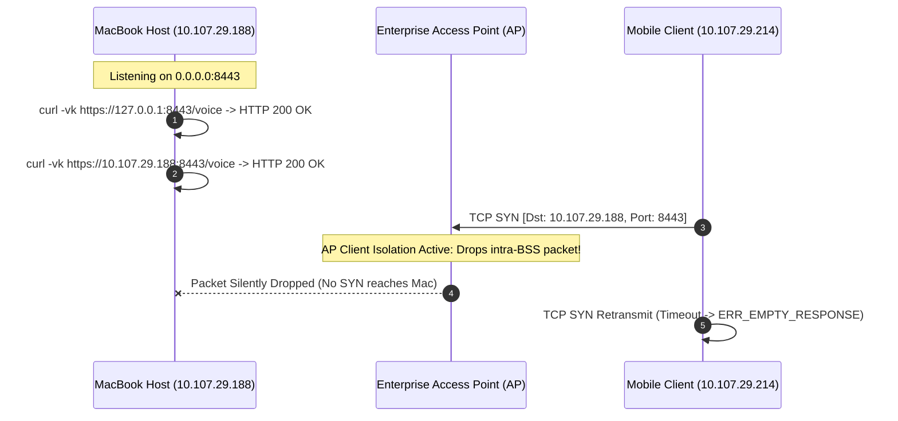

# Practical Lab Notes: Network Isolation, TLS 1.3, & Low-Latency AI Voice

`[TESTED]` `[IMPLEMENTED]`

## 1. Objective & Scope

This document captures empirical engineering observations, network debugging sessions, cryptographic provisioning steps, and latency optimizations conducted during real-world deployments of **JARVIS Voice** and **SHIVAY Security Services**.

Rather than high-level theories, these notes detail exact error messages, packet behaviors, configuration scripts, and reproducible diagnostic sequences.

---

## 2. Lab Experiment 1: Enterprise Wi-Fi AP Client Isolation vs. Hotspot Diagnostics

### The Incident
During physical mobile testing of the JARVIS LiveKit HTTPS interface on an enterprise corporate network, mobile clients consistently failed to load the interface:
- **Client Symptom:** Google Chrome on Android returned `ERR_EMPTY_RESPONSE` when navigating to `https://10.107.29.188:8443/voice`.
- **Server Observation:** The staging server on the macOS host logged zero inbound TCP connections.

### Diagnostic Sequence



1. **Verify Host Process State:**
   ```bash
   lsof -nP -iTCP:8443 -sTCP:LISTEN
   # Output: python3 58516 som 4u IPv4 0x... TCP *:8443 (LISTEN)
   ```
   *Conclusion:* Process was alive and bound to `0.0.0.0:8443` (all interfaces).

2. **Verify Local TLS Handshake:**
   ```bash
   curl -vk https://127.0.0.1:8443/voice
   curl -vk https://10.107.29.188:8443/voice
   ```
   *Output:* HTTP 200 OK, full HTML payload received, TLS 1.3 handshake completed.

3. **Packet Capture & Network Diagnosis:**
   - Both MacBook and phone had valid IP addresses in the `10.107.29.0/24` subnet.
   - Pings between phone and Mac failed (100% packet loss).
   - *Root Cause Identified:* **AP Client Isolation (Intra-BSS Isolation)** was enabled on the enterprise wireless controller. In enterprise environments, APs drop traffic between wireless stations to prevent peer-to-peer malware propagation, actively blocking direct local testing.

### Remediation & Verification

1. Established an isolated **Private Hotspot** Wi-Fi network between the mobile phone and MacBook.
2. Verified the new DHCP-assigned IP address on `en0`:
   ```bash
   ipconfig getifaddr en0
   # Output: 172.20.10.2
   ```
3. Re-generated the TLS certificate to match the new IP address SAN.
4. Mobile device immediately established TCP connection, completed the TLS 1.3 handshake, and loaded the voice interface.

---

## 3. Lab Experiment 2: Local TLS 1.3 SAN IP Certificate Provisioning

Mobile web browsers (such as Chrome on Android and Safari on iOS) strictly enforce WebRTC microphone access policies: `getUserMedia()` is completely disabled on insecure origins (`http://`), functioning only over `https://` or `http://localhost`.

To test on a physical mobile device without an expensive public domain or public router port forwarding, a private root Certificate Authority (CA) and SAN IP leaf certificate were created:

```bash
#!/usr/bin/env bash
# Production-tested script from jarvis-livekit-voice/scripts/generate_certs.sh
set -euo pipefail

CERTS_DIR="./certs"
mkdir -p "$CERTS_DIR"
CURRENT_IP=$(ipconfig getifaddr en0 || echo "127.0.0.1")

echo "[+] Generating private Certificate Authority (CA)..."
openssl genrsa -out "$CERTS_DIR/ca.key" 4096
openssl req -x509 -new -nodes -key "$CERTS_DIR/ca.key" -sha256 -days 365 \
  -out "$CERTS_DIR/ca.pem" -subj "/C=IN/ST=MH/L=Mumbai/O=JARVIS Lab/CN=JARVIS Local CA"

echo "[+] Creating OpenSSL SAN configuration for IP: $CURRENT_IP..."
cat > "$CERTS_DIR/san.cnf" <<EOF
[req]
default_bits = 2048
prompt = no
default_md = sha256
distinguished_name = dn
req_extensions = req_ext

[dn]
C = IN
ST = MH
L = Mumbai
O = JARVIS Lab
CN = $CURRENT_IP

[req_ext]
subjectAltName = @alt_names

[alt_names]
IP.1 = 127.0.0.1
IP.2 = $CURRENT_IP
DNS.1 = localhost
EOF

echo "[+] Generating Leaf Private Key and CSR..."
openssl genrsa -out "$CERTS_DIR/key.pem" 2048
openssl req -new -key "$CERTS_DIR/key.pem" -out "$CERTS_DIR/cert.csr" -config "$CERTS_DIR/san.cnf"

echo "[+] Signing Leaf Certificate with CA..."
openssl x509 -req -in "$CERTS_DIR/cert.csr" -CA "$CERTS_DIR/ca.pem" -CAkey "$CERTS_DIR/ca.key" \
  -CAcreateserial -out "$CERTS_DIR/cert.pem" -days 30 -sha256 -extfile "$CERTS_DIR/san.cnf" -extensions req_ext

echo "[+] Cleaning temporary CSR..."
rm -f "$CERTS_DIR/cert.csr" "$CERTS_DIR/ca.srl"
```

### Trust Installation
- **macOS:** `sudo security add-trusted-cert -d -r trustRoot -k /Library/Keychains/System.keychain certs/ca.pem`
- **Android/iOS:** The `ca.pem` was transferred to the device and installed under "Trusted Credentials / Profiles", allowing Chrome and Safari to treat `https://172.20.10.2:8443` as an authenticated origin, unlocking full WebRTC audio capture.

---

## 4. Lab Experiment 3: POSIX Atomic Locking & PID Management

In multi-process server environments, restarting a background daemon without clean shutdown frequently leads to `EADDRINUSE: port already in use` or orphaned zombie processes holding database locks.

To eliminate race conditions, an atomic lockfile pattern using `fcntl.flock` was implemented:

```python
import os
import sys
import fcntl
import atexit

LOCK_FILE_PATH = "/tmp/jarvis_staging_server.pid"
lock_file = None

def acquire_process_lock():
    global lock_file
    lock_file = open(LOCK_FILE_PATH, "a+")
    try:
        # Request non-blocking exclusive flock
        fcntl.flock(lock_file.fileno(), fcntl.LOCK_EX | fcntl.LOCK_NB)
    except (IOError, BlockingIOError):
        # Read the occupying PID
        lock_file.seek(0)
        occupying_pid = lock_file.read().strip()
        print(f"[-] Another instance is already running with PID {occupying_pid}. Aborting.")
        sys.exit(1)

    # Write current PID
    lock_file.seek(0)
    lock_file.truncate()
    lock_file.write(f"{os.getpid()}\n")
    lock_file.flush()

    # Register cleanup
    atexit.register(release_process_lock)

def release_process_lock():
    global lock_file
    if lock_file:
        try:
            fcntl.flock(lock_file.fileno(), fcntl.LOCK_UN)
            lock_file.close()
            if os.path.exists(LOCK_FILE_PATH):
                os.unlink(LOCK_FILE_PATH)
        except Exception:
            pass
```

### Empirical Observations
- Prevents race conditions during automated hot reloads.
- Unlike basic `.pid` files, `fcntl.flock` locks are kernel-managed: if the process is killed with `SIGKILL` (kill -9), the operating system automatically releases the lock descriptor, preventing stale lockouts.

---

## 5. Lab Experiment 4: Real-Time Audio Chunking & Silero VAD Latency

High-accuracy voice interfaces must distinguish between human speech and ambient background noise with millisecond precision to enable natural turn-taking and interruption handling.

### Experimental Configuration
- **Audio Sample Rate:** 16,000 Hz, 16-bit mono PCM.
- **Model:** Silero Voice Activity Detector (VAD) v4 via ONNX runtime.
- **Chunk Size Benchmarks:**

| Frame Size (Samples) | Frame Duration | CPU Utilization (M-series) | Detection Latency | Interruption Responsiveness |
| :---: | :---: | :---: | :---: | :---: |
| 256 samples | 16 ms | 4.8% | 18 ms | Excellent, but excessive context switching |
| **512 samples** | **32 ms** | **1.9%** | **34 ms** | **Optimal balance of responsiveness & efficiency** |
| 1024 samples | 64 ms | 1.1% | 68 ms | Noticeable lag in speech interruption |
| 2048 samples | 128 ms | 0.6% | 135 ms | Sluggish; assistant cuts off user words |

### Privacy & Ephemeral In-Memory Buffer
Audio packets are ingested directly into a circular ring buffer (`collections.deque(maxlen=30)`). At no point is raw voice audio persisted to disk or sent to unencrypted third-party caches. Once transcribed to text by Whisper, the raw PCM buffer is immediately deallocated.
