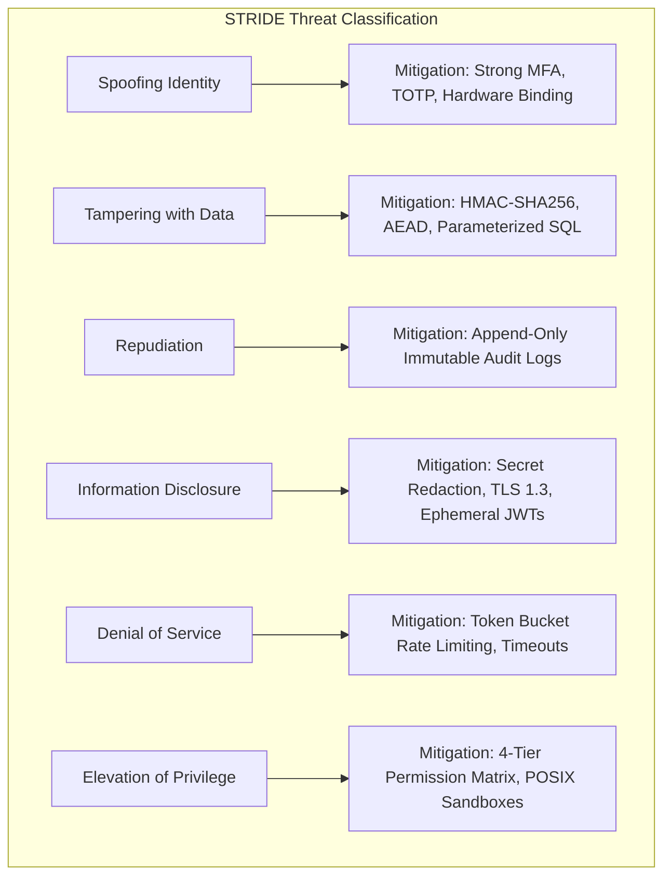
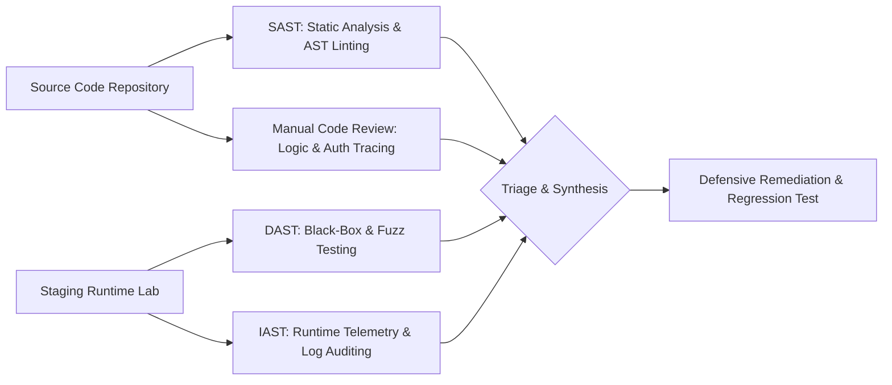

# Defensive Security Research & Vulnerability Assessment Methodology

`[RESEARCH]` `[IMPLEMENTED]`

## 1. Principles of Defensive Security Research

Rigorous defensive cybersecurity research bridges the gap between theoretical vulnerability taxonomies (such as CVEs, CWEs, and OWASP guides) and real-world system resilience. Unlike adversarial exploitation, defensive research focuses on **threat modeling, root-cause vulnerability analysis, architectural mitigation, and automated regression verification**.

### Core Tenets of Ethical Security Analysis

1. **Authorization and Scope Boundaries (Rules of Engagement):**
   - Active network scanning, fuzzing, or credential verification must strictly occur against explicitly owned environments, authorized staging labs, or sandbox virtual machines.
   - Probing third-party production infrastructure without explicit, written authorization is unethical and violates computer fraud legislation (e.g., CFAA, IT Act Section 43/66).
   - When source code or explicit test environments are unavailable, assessments must be reported as *inconclusive* rather than guessing or performing unauthorized runtime probes.

2. **Evidence-Grounded Reporting:**
   - Every identified issue must be backed by reproducible code paths, network traces, or automated test assertions.
   - Assumptions must be clearly distinguished from empirical findings.

3. **Responsible Disclosure (RFC 9116 & ISO/IEC 29147):**
   - Vulnerabilities discovered in open-source dependencies or external platforms are handled under coordinated disclosure timelines (typically 90 days), providing maintainers with remediated pull requests or patches before public publication.

---

## 2. Threat Modeling Frameworks

Effective defensive engineering begins before code is written, utilizing structured threat modeling:



### The STRIDE Matrix in Practice

| Threat Category | Target Asset | Real-World Attack Scenario | Implemented Mitigation |
| :--- | :--- | :--- | :--- |
| **Spoofing** | API Endpoints | Attacker replays stolen session token or spoofs webhook origin | HMAC-SHA256 signature verification + 300s timestamp freshness window |
| **Tampering** | Local Database | Malicious payload modifies ledger balances or alters pending tasks | Parameterized queries + SQLite Foreign Key pragmas + In-memory isolated staging |
| **Repudiation** | Consequential Actions | Compromised client denies executing a destructive host action | Strict signed approval tokens (`ApprovalService`) logged to persistent audit table |
| **Information Disclosure** | Subprocess Logs | Exception traces or child process stdout leak API keys to console | Dynamic regex redactor (`secret_redactor.py`) scrubbing all output streams |
| **Denial of Service** | Voice Pipeline | High-frequency audio packets or HTTP flood overwhelm AI endpoints | Sliding-window token bucket rate limiter + Silero VAD energy gating |
| **Elevation of Privilege** | Agent Tool Engine | LLM prompt injection attempts to spawn root shell via subprocess | Strict binary allowlisting (`ProcessGuard`) + `shell=False` parameterization |

---

## 3. Vulnerability Analysis Methodologies

Modern application security requires a hybrid verification pipeline:



1. **Static Application Security Testing (SAST):**
   - Syntax and dependency analysis using AST parsers (`bandit`, `ruff`, `semgrep`).
   - Identifies insecure imports (`pickle`, `marshal`), hardcoded passwords, and weak pseudo-random generators (`random` instead of `secrets`).
2. **Dynamic Application Security Testing (DAST):**
   - Active fuzzing of HTTP headers, URL parameters, and input schemas on isolated test servers.
   - Evaluates defensive response codes, CORS policies, and rate-limiting behavior under burst conditions.
3. **Manual Source Code Review:**
   - Traces execution paths from untrusted user inputs (HTTP query parameters, voice transcripts, webhook bodies) to internal data sinks (database queries, filesystem writes, subprocess calls).
   - Verifies authorization boundaries on every API route independently of frontend UI controls.

---

## 4. Case Study: The 20-Pillar Automated Web Security Auditor

To automate defensive security assessments of web assets without using heavy third-party scanners, an independent 20-pillar auditing engine was engineered in `shivai/src/shivai/security/website_auditor.py`.

### Architecture of the Auditor

The engine performs non-destructive, zero-exploit inspections across 20 distinct security vectors:

```python
# Architecture excerpt from shivai/src/shivai/security/website_auditor.py
class WebsiteAuditor:
    """Non-destructive defensive security auditor covering 20 pillars of web security."""

    PILLARS = [
        "HTTPS Enforced & HSTS Present",
        "TLS 1.2+ Supported & Weak Ciphers Rejected",
        "Content Security Policy (CSP) Configured",
        "X-Frame-Options (Clickjacking Defense)",
        "X-Content-Type-Options (MIME-Sniffing Defense)",
        "Strict-Transport-Security Max-Age Adequate",
        "Referrer-Policy Configured Securely",
        "Permissions-Policy (Feature Policy) Present",
        "Cookie Security (Secure, HttpOnly, SameSite)",
        "Server Version Banner Redacted",
        "CORS Headers Restricted (No Wildcard with Credentials)",
        "Subresource Integrity (SRI) on External Scripts",
        "Open Redirection Defenses",
        "Robots.txt & Security.txt Disclosed",
        "DNSSEC Implementation",
        "SPF / DMARC Email Spoofing Defense",
        "HTTP Methods Restricted (OPTIONS, TRACE Disabled)",
        "Certificate Transparency Logs Checked",
        "API Error Leaks (No Stack Traces in 500 Responses)",
        "Rate Limiting & DoS Shield Indicators"
    ]
```

### Key Engineering Lessons

1. **Zero-Exploit Philosophy:** A defensive audit tool should never send malicious exploit payloads (e.g., `' OR '1'='1`, `<script>alert(1)</script>`) to public targets. Instead, it inspects metadata, HTTP response headers, TLS handshake parameters, and certificate trust chains.
2. **Score Normalization:** Audits produce a deterministic 0-100 security score based on weighted deductions:
   - High-severity deductions: Missing HTTPS (-25), Weak TLS (-20), Insecure Cookies (-15).
   - Medium-severity deductions: Missing CSP (-10), Missing X-Frame-Options (-10).
   - Informational: Missing `security.txt` (-2).

---

## 5. Responsible Disclosure Protocol (RFC 9116)

When conducting security research, systems should publish and support `/.well-known/security.txt` to streamline communication between external security researchers and engineering teams.

### Standard `security.txt` Format
```http
Contact: mailto:security@example.com
Expires: 2027-12-31T23:59:59.000Z
Encryption: https://example.com/pgp-key.txt
Preferred-Languages: en
Policy: https://example.com/disclosure-policy.html
Hiring: https://example.com/careers
```

By formalizing scope boundaries, static/dynamic analysis pipelines, and responsible disclosure protocols, defensive research ensures that software systems are continuously hardened against modern adversarial tactics.
