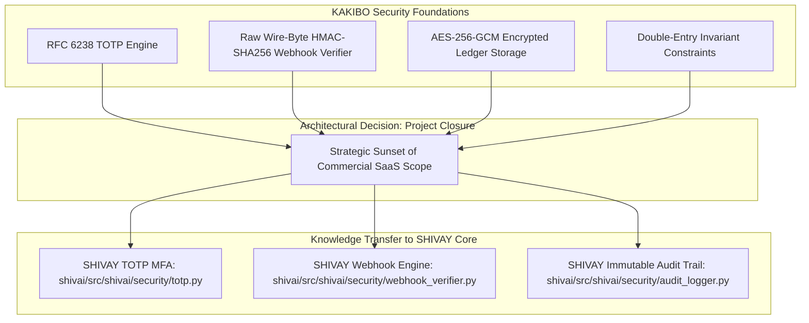
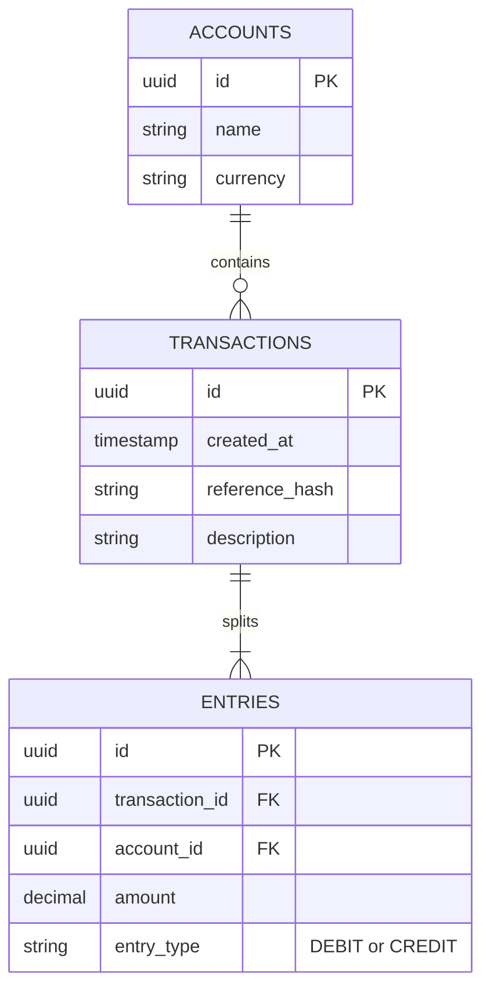

# Case Study & Retrospective: KAKIBO — Personal Finance Security, Webhook Cryptography, & Strategic Decoupling

`[IMPLEMENTED]` `[RESEARCH]`

## 1. Project Context & Retrospective

**KAKIBO** was conceived as a secure personal finance, billing, and double-entry ledger platform designed to handle sensitive monetary transactions, recurring subscriptions, and banking reconciliation. Because financial systems are prime targets for fraud, data tampering, and replay attacks, KAKIBO was built from day one with stringent application security standards:
- **Multi-Factor Authentication (MFA)** powered by RFC 6238 TOTP.
- **Envelope Encryption** for sensitive financial records using AES-256-GCM.
- **Cryptographic Webhook Verification** for payment gateway integration (Razorpay).
- **Double-Entry Accounting Invariants** enforced at the relational database level.

Following an architectural review, the commercial billing and business operations of KAKIBO were **intentionally sunsetted and discontinued**. This decision allowed engineering focus to pivot entirely to core autonomous AI systems, OS-level security engineering, and defensive research in **SHIVAY** and **JARVIS**.

Crucially, **all security engineering assets and cryptographic implementations developed for KAKIBO were extracted, modernized, and permanently transferred to the SHIVAY core security perimeter**. This case study documents those reusable security architectures.



---

## 2. Cryptographic Webhook Verification (The Wire-Byte Trap)

Payment gateways (such as Razorpay or Stripe) communicate payment completions via asynchronous HTTP webhooks. If an attacker can forge or replay a webhook payload, they can credit accounts with arbitrary funds without transferring real money.

### The Wire-Byte Serialization Vulnerability

A subtle and dangerous vulnerability in webhook verification occurs when developers verify signatures against deserialized JSON objects:

```python
# VULNERABLE IMPLEMENTATION
payload = await request.json()  # Dict representation
raw_string = json.dumps(payload)  # Re-serialized string!
expected_signature = hmac.new(secret, raw_string.encode(), hashlib.sha256).hexdigest()
```

**Why this fails:**
JSON serialization is non-deterministic:
- Key order may shift (`{"a": 1, "b": 2}` vs `{"b": 2, "a": 1}`).
- Floating-point representations vary (`100.0` vs `100.00`).
- Whitespace formatting differs (`{"a":1}` vs `{"a": 1}`).

If the signature mismatches due to formatting, developers are tempted to disable verification or loosen checks, introducing catastrophic forgery risks.

### The Secure Implementation (`webhook_verifier.py`)

In KAKIBO and SHIVAY, verification is performed exclusively against the **exact raw bytes off the network wire** before any JSON parsing occurs:

```python
# Implementation pattern from shivai/src/shivai/security/webhook_verifier.py
import hmac
import hashlib
import time

class WebhookVerificationError(ValueError):
    """Raised when webhook signature verification fails."""
    pass

class WebhookVerifier:
    REPLAY_TOLERANCE_SECONDS = 300  # 5-minute freshness window

    @classmethod
    def verify_signature(cls, raw_body_bytes: bytes, signature_header: str, secret: str) -> bool:
        """
        Verifies raw wire-bytes using HMAC-SHA256 and constant-time comparison.
        """
        if not raw_body_bytes or not signature_header or not secret:
            raise WebhookVerificationError("Missing body, signature header, or signing secret.")

        # Compute HMAC over raw bytes
        computed_mac = hmac.new(
            secret.encode("utf-8"),
            msg=raw_body_bytes,
            digestmod=hashlib.sha256
        ).hexdigest()

        # Constant-time comparison prevents timing side-channel attacks
        if not hmac.compare_digest(computed_mac, signature_header.strip()):
            raise WebhookVerificationError("Webhook HMAC signature mismatch.")

        return True

    @classmethod
    def verify_timestamp_freshness(cls, timestamp_header: int) -> bool:
        """Mitigates replay attacks by enforcing a strict time window."""
        current_time = int(time.time())
        if abs(current_time - timestamp_header) > cls.REPLAY_TOLERANCE_SECONDS:
            raise WebhookVerificationError("Webhook timestamp expired (replay attack defense).")
        return True
```

---

## 3. RFC 6238 Time-Based One-Time Passwords (TOTP)

To protect administrative financial accounts against credential stuffing and session theft, KAKIBO implemented native RFC 6238 TOTP authentication without relying on external SaaS identity vendors.

### Mathematical Algorithm & Truncation
1. **Time Step Formulation:**
   $$T = \lfloor \frac{\text{Current Unix Timestamp} - T_0}{X} \rfloor$$
   Where $T_0 = 0$ and $X = 30$ seconds.
2. **HMAC Generation:**
   $$HS = \text{HMAC-SHA1}(K, T)$$
   Where $K$ is the base32-decoded shared secret key.
3. **Dynamic Truncation (RFC 4226 §5.4):**
   Extracts the last 4 bits of $HS[19]$ as offset $O$, deriving a 31-bit integer:
   $$Code = (HS[O \dots O+3] \ \& \ \text{0x7FFFFFFF}) \pmod{10^6}$$
4. **Clock Drift Tolerance ($\pm 1$ Step):**
   The engine checks $T-1$, $T$, and $T+1$ (covering a 90-second total window) to accommodate mobile device clock skew without compromising security.

This engine was extracted and preserved in `shivai/src/shivai/security/totp.py`, where it now secures the local administrative dashboard of SHIVAY.

---

## 4. Double-Entry Invariants & Anti-Tampering

Financial integrity cannot rely solely on application logic; it must be backed by database constraints:



### Invariants Enforced
1. **Mathematical Balance:** For every transaction, the sum of debits must equal the sum of credits ($\sum \text{Debits} - \sum \text{Credits} = 0$). Transactions violating this rule are rejected by an atomic SQLite trigger.
2. **Immutability (No SQL UPDATEs):** Posted transactions are append-only. Corrections require an explicit reversing entry, ensuring a complete and tamper-evident audit history.
3. **Envelope Encryption:** Stored account identifiers and sensitive financial metadata are encrypted with **AES-256-GCM** using unique 96-bit initialization vectors (IVs) and 128-bit authentication tags.

---

## 5. Strategic Decoupling & Lessons Learned

1. **Focus Over Scope Creep:** Building a commercial billing engine requires extensive regulatory compliance (PCI-DSS, GST/tax reconciliation, KYC banking audits). By shutting down the commercial SaaS aspects of KAKIBO, engineering bandwidth was consolidated where the highest impact lay: advanced AI reasoning, secure autonomous agents, and OS-level security.
2. **Extract Reusable Security Assets:** Discontinuing a project does not mean losing its engineering value. The cryptographic code, TOTP implementation, webhook verification, and automated security tests developed for KAKIBO directly elevated the security posture of SHIVAY.
3. **Security is Universal:** Whether securing a payment webhook or securing an autonomous AI agent's bash execution, the underlying principles are identical: validate inputs on raw wire bytes, enforce least privilege, fail closed, and log all events to an append-only audit trail.
