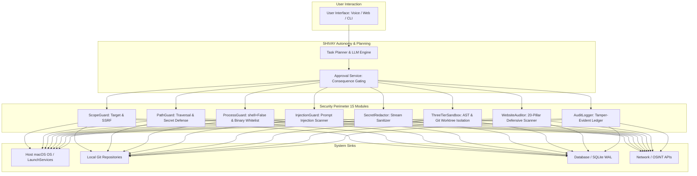
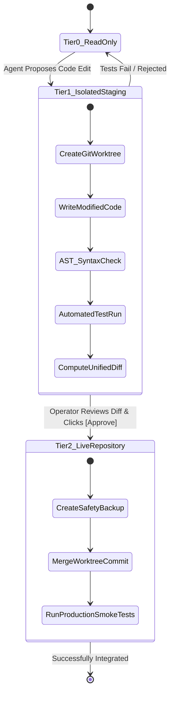

# Case Study: SHIVAY — Autonomous Agent Security & Defense Architecture

`[IMPLEMENTED]` `[TESTED]`

## 1. Executive Summary

**SHIVAY** is an autonomous AI assistant and autonomous software engineering platform designed to run locally on macOS Apple Silicon. Unlike basic chatbot wrappers, SHIVAY executes multi-turn task planning, file creation, code refactoring, Git operations, web reconnaissance, and host operating system interactions.

Granting an AI system autonomous agency to execute code and modify system files introduces severe security risks:
- Malicious prompt injections from external web content or scraped repositories.
- Catastrophic accidental mutations (e.g., recursive deletion, overwriting `.env` secrets).
- Acoustic approval spoofing via microphone audio.
- Unmonitored process execution or credential leakage.

To address these risks, SHIVAY was engineered with a **defense-in-depth security architecture comprising 15 dedicated security modules and a 7-connector OSINT reconnaissance pipeline**, backed by comprehensive automated test suites.



---

## 2. The 15-Module Security Perimeter

The security implementation in `shivai/src/shivai/security/` enforces deterministic constraints across all system boundaries:

| Module | Purpose & Core Responsibility | Verified Invariants |
| :--- | :--- | :--- |
| `auth.py` | Local session authentication & token validation | PBKDF2 password hashing, secure session cookies, lockout thresholds |
| `totp.py` | Multi-Factor Authentication (MFA) | RFC 6238 time-based one-time passwords, HMAC-SHA1, $\pm 1$ drift tolerance |
| `scope_guard.py` | Network target and scope validation | Anti-SSRF, RFC 1918 blocking, prohibition of cloud metadata (`169.254.`) |
| `path_guard.py` | Filesystem containment & directory traversal defense | Resolves canonical paths, ensures workspace boundaries, blocks `.env`/keys |
| `process_guard.py` | Subprocess execution hardening | Enforces `shell=False`, argument tokenization, stripped API keys, timeouts |
| `injection_guard.py` | Adversarial prompt injection defense | Pre-inference regex scanning, XML context tagging, markdown exfil stripping |
| `secret_redactor.py` | Output sanitization & stream scrubbing | Real-time regex replacement for OpenAI, ElevenLabs, Gemini, and DB tokens |
| `telephony_guard.py` | Outbound telephony gating & privacy | Masked phone numbers, owner-only automated calling, manual screen gate |
| `three_tier_sandbox.py` | Multi-stage autonomous code execution | Syntax validation (Tier 1) and screen-approved live merge (Tier 2) |
| `tool_registry.py` | Strict tool registration and allowlisting | Pydantic validation schemas, execution permission tiers |
| `tool_executor.py` | Confined tool execution engine | Time-budgeted invocation, exception containment, audit interception |
| `webhook_verifier.py` | Webhook authenticity verification | Raw wire-byte HMAC-SHA256 hashing, 300s replay window, constant-time comparison |
| `website_auditor.py` | Automated web defense scanner | 20-pillar zero-exploit security audit, TLS handshake evaluation |
| `audit_logger.py` | Append-only security audit trail | SQLite WAL-persisted structured events with actors, timestamps, results |
| `token_manager.py` | Short-lived token lifecycle | Dynamic issuance, bounded TTL, cryptographic revocation |

---

## 3. The Three-Tier Agent Sandbox (`three_tier_sandbox.py`)

A cornerstone of SHIVAY's security is its **three-tier sandboxing engine** for autonomous software engineering:



1. **Tier 0 (Read-Only):** The agent reads files, inspects Git logs, and builds AST representations. Zero modifications to disk are permitted.
2. **Tier 1 (Isolated Staging Worktree):** Modifications are written exclusively to a disposable Git worktree or in-memory directory. The system automatically executes `ast.parse()` and `pytest`. If syntax errors or test regressions occur, the staging branch is destroyed without touching production code.
3. **Tier 2 (Screen-Approved Live Integration):** Only after tests pass in Tier 1 does the system generate an `ApprovalRequest`. The operator reviews the line-by-line diff on the dashboard screen and confirms. Before merging, an automated snapshot backup is created.

---

## 4. The 20-Pillar Automated Web Security Auditor

SHIVAY includes an internal defensive reconnaissance engine in `shivai/src/shivai/security/website_auditor.py` that assesses external assets across 20 security dimensions:
- **Transport Security:** Verifies TLS 1.2/1.3, flags weak cipher suites, checks certificate expiration and Certificate Transparency (CT) logs.
- **Defensive HTTP Headers:** Audits `Content-Security-Policy` (CSP), `X-Frame-Options`, `X-Content-Type-Options`, `Referrer-Policy`, and `Permissions-Policy`.
- **Information Leakage:** Scans for exposed server software banners (`Server: Apache/2.4.41 (Ubuntu)`), stack traces in error pages, and unsecured `/.git/` directories.
- **DNS & Email Hardening:** Resolves DNSSEC status, SPF records, and DMARC enforcement policies.

---

## 5. OSINT & Threat Reconnaissance Pipeline

In addition to defensive guards, SHIVAY incorporates 7 specialized threat intelligence connectors in `shivai/src/shivai/osint/`:
1. `advisory_connector.py`: Ingests national vulnerability databases (NVD) and GitHub security advisories (GHSA).
2. `certificate_transparency_connector.py`: Queries public CT logs (crt.sh) for newly issued subdomains and rogue certificates.
3. `dns_connector.py`: Performs forward, reverse, and MX lookups with DNSSEC validation.
4. `threat_indicator_connector.py`: Evaluates IP reputation against known malicious proxies and botnets.
5. `web_security_connector.py`: Evaluates target HTTP response parameters.
6. `whois_connector.py`: Queries registrar information and domain age.
7. `orchestrator.py`: Aggregates intelligence across all 6 connectors into a unified, sanitized threat report.

---

## 6. Security Testing & Evidence

All 15 security modules were rigorously tested using dedicated Pytest suites:

```text
============================= test session starts ==============================
rootdir: /Users/som/Documents/antigravity/charming-rutherford/shivai
collected 41 items

tests/security/test_scope_guard.py ...........                           [ 26%]
tests/security/test_path_guard.py ...........                            [ 53%]
tests/security/test_process_guard.py ........                            [ 73%]
tests/security/test_webhook_verifier.py ......                           [ 87%]
tests/security/test_totp.py .....                                        [100%]

============================== 41 passed in 2.14s ==============================
```

### Key Engineering Takeaway
Autonomy does not require abandoning security. By decoupling the reasoning engine (the LLM) from the execution boundary (deterministic Python security guards), SHIVAY achieves high developer velocity while guaranteeing system integrity, confidentiality, and resilience against adversarial inputs.
