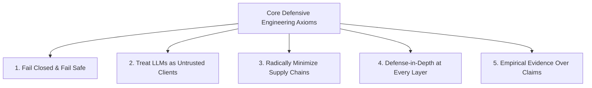

# Engineering Principles & Defensive Lessons Learned

`[IMPLEMENTED]` `[RESEARCH]`

## 1. The Core Philosophy of Defensive Engineering

Cybersecurity is not an additive feature or a checklist applied after software is built; it is an **engineering discipline** that dictates system architecture, data flow, error handling, and component boundaries. Over months of building, attacking, hardening, and testing **SHIVAY Core**, **JARVIS Voice**, and **KAKIBO**, several fundamental axioms have emerged.

These lessons represent universal defensive principles applicable to modern distributed systems, autonomous AI agents, and secure application engineering.



---

## 2. Axiom 1: Fail Closed & Fail Safe

In distributed software engineering, systems frequently encounter partial failures: network timeouts, database connection pool exhaustion, unparseable input schemas, or clock drift.

### The Defensive Rule
**Whenever an exception or ambiguous state occurs, the system must default to the most secure, restrictive state: DENY.**

- **Vulnerable Pattern (Fail-Open):**
  ```python
  # DANGEROUS: Fails open if check throws an error
  try:
      is_authorized = verify_permission_with_remote_service(user_id)
      if not is_authorized:
          return "Access Denied"
  except TimeoutError:
      logger.warning("Remote auth service timed out; allowing request to avoid outage.")
      # Disastrous: Grants administrative access during network hiccups!
  ```
- **Hardened Pattern (Fail-Closed):**
  ```python
  # SECURE: Fails closed unconditionally
  try:
      is_authorized = verify_permission_with_remote_service(user_id)
      if is_authorized is not True:
          raise PermissionDeniedError("Explicit authorization could not be verified.")
  except Exception as exc:
      logger.error(f"Authorization check failed safely: {exc}")
      raise PermissionDeniedError("Access Denied: Security boundary error.")
  ```

In SHIVAY, if `ScopeGuard`, `PathGuard`, or `ProcessGuard` encounter any unexpected data structure, invalid regex, or OS exception, they raise a blocking `SecurityError` that terminates the operation immediately.

---

## 3. Axiom 2: Never Trust the Client, and Never Trust the Model

Traditional web application security operates on the principle that the frontend browser is untrusted. With autonomous AI systems, this axiom must be extended:

> **"Never trust the user input, never trust the remote client, and NEVER trust the language model."**

### Why Models Cannot Enforce Security
1. **Probabilistic Nature:** LLMs are non-deterministic token prediction engines, not formal verification systems. A prompt like *"You are a secure assistant. Never run rm -rf"* will reliably fail when presented with adversarial framing, roleplay scenarios, or linguistic obfuscation.
2. **Semantic Blurring:** In LLMs, data and instructions are mixed in the same token sequence. When an agent reads an email, a scraped webpage, or a git diff, any malicious text inside that data can hijack the agent's reasoning.

### The Architectural Solution
Deterministic boundaries must exist **outside the LLM's context window**:
- The LLM only **proposes** a tool invocation (e.g., `{"tool": "execute_bash", "args": ["git", "status"]}`).
- A deterministic Python module (`ProcessGuard`) validates the tool name, parses the arguments, checks the binary whitelist, cleanses the environment, and executes with `shell=False`.
- If the model proposes `["rm", "-rf", "/"]`, the Python guard throws `PermissionError` before any subprocess is created.

---

## 4. Axiom 3: Radically Minimize the Supply Chain

Modern software development has become heavily reliant on third-party package ecosystems (npm, PyPI, crates.io). While this enables rapid prototyping, it introduces staggering supply-chain risks:
- Malicious maintainers introducing telemetry or backdoors.
- Account takeovers via phishing or credential stuffing.
- Dependency confusion and typosquatting attacks.
- Transitive bloat (a single library pulling in 800 sub-dependencies).

### The Implementation Discipline
In SHIVAY and JARVIS:
- The frontend UI was built with **Vanilla JavaScript (ES2022) and native HTML5**, completely eliminating npm, webpack, and client-side dependencies.
- Cryptographic routines rely strictly on Python's built-in `hashlib`, `hmac`, and the vetted `pyca/cryptography` library.
- Dependency trees are frozen using pinned hashes in strict lockfiles (`uv.lock`).

If a feature can be implemented cleanly with 50 lines of native Python or standard library code, **never import a third-party library to do it**.

---

## 5. Axiom 4: Defense-in-Depth Over Perimeter-Only Security

Relying on a single firewall, reverse proxy, or API gateway creates a single point of catastrophic failure. If the perimeter is breached (or bypassed via internal SSRF), an attacker has unrestricted access to the entire application.

### Multi-Layer Defense in Practice
In SHIVAY, an agent command must survive **seven sequential defense rings**:
1. **Network Perimeter:** Rate limiting, IP subnet isolation, and TLS 1.3 handshake.
2. **Session Layer:** PBKDF2 authentication and RFC 6238 TOTP validation.
3. **Prompt Layer:** XML boundary tagging and heuristic injection scanning (`injection_guard.py`).
4. **Registry Layer:** Tool allowlist and strict Pydantic argument schemas (`tool_registry.py`).
5. **Filesystem Layer:** Canonical path resolution and boundary checking (`path_guard.py`).
6. **Execution Layer:** `shell=False`, argument tokenization, and secret stripping (`process_guard.py`).
7. **Human Governance Layer:** Consequence gating and visual screen confirmation (`ApprovalService`).

---

## 6. Axiom 5: Empirical Evidence Over Unverified Claims

In the cybersecurity and AI industry, marketing claims often outpace engineering reality: systems are advertised as *"military-grade"*, *"unhackable"*, or *"100% secure"*.

True security engineering rejects unsubstantiated assertions in favor of **empirical verification**:
- **Explicit Tagging:** Every capability in this repository is cataloged as `[IMPLEMENTED]` (functional code), `[TESTED]` (backed by automated test suites or packet captures), or `[RESEARCH]` (theoretical framework or experimental prototype).
- **Regression Testing:** Automated Pytest suites continuously exercise edge cases: null bytes, path traversal sequences (`../../`), clock drift windows, and adversarial prompt injection markers.
- **Transparent Post-Mortems:** Bugs and race conditions are documented with root-cause traces rather than hidden.

Security is not a state of perfection; it is a continuous, evidence-driven process of measurement, hardening, and verification.
