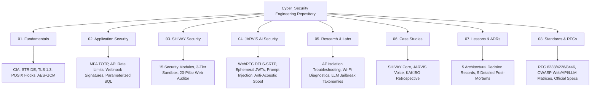

# Cybersecurity Engineering & Defensive Systems Research

[](LICENSE.md)
[](IMPLEMENTATION_INVENTORY.md)
[](04_JARVIS_AI_SECURITY/AI_Agent_Security.md)
[](08_REFERENCES/OWASP_References.md)

Welcome to the **Cybersecurity Engineering & Defensive Systems Research Knowledge Base**. This repository serves as an evidence-grounded engineering portfolio and technical knowledge repository maintained by **Som Choudhary**.

It synthesizes real-world cybersecurity implementations, cryptographic engines, multi-layer perimeter defenses, and threat models developed across large-scale engineering projects — including **SHIVAY Core** (an autonomous developer agent), **JARVIS** (a real-time voice assistant and emergency monitoring platform), and **KAKIBO** (a secure double-entry billing and financial ledger system).

---

## Repository Architecture & Knowledge Domains



---

## Evidence & Verification Standard

Every technical explanation, architecture diagram, and capability in this repository adheres to a strict three-tier verification standard:

- `[IMPLEMENTED]`: Denotes production-ready code authored, deployed, and operational in existing systems.
- `[TESTED]`: Denotes mechanisms backed by automated Pytest suites, network packet captures, or verified lab reproductions.
- `[RESEARCH]`: Denotes threat modeling, theoretical vulnerability taxonomies, or experimental defensive prototypes.

For a comprehensive file-by-file status audit, refer to the [Implementation Inventory Matrix](IMPLEMENTATION_INVENTORY.md).

---

## Table of Contents

### [01. Cybersecurity Fundamentals](01_CYBERSECURITY_FUNDAMENTALS/)
Foundational security principles, network protocols, operating system internals, and applied cryptography:
- [Security Fundamentals](01_CYBERSECURITY_FUNDAMENTALS/Security_Fundamentals.md) — The CIA triad, STRIDE threat modeling, least privilege, and defense-in-depth principles.
- [Networking Fundamentals](01_CYBERSECURITY_FUNDAMENTALS/Networking_Fundamentals.md) — OSI/TCP models, TLS 1.3 handshake mechanics, SAN IP certificate provisioning, and WebRTC NAT traversal.
- [Linux & Operating System Security](01_CYBERSECURITY_FUNDAMENTALS/Linux_Security.md) — POSIX file permissions, atomic `fcntl.flock` process locking, environment sanitization, and privilege boundaries.
- [Cryptography Fundamentals](01_CYBERSECURITY_FUNDAMENTALS/Cryptography_Fundamentals.md) — Cryptographic hashes (SHA-256), HMAC message authentication, AES-256-GCM authenticated encryption, and timing-attack-safe comparisons.

### [02. Application Security](02_APPLICATION_SECURITY/)
Defensive engineering patterns for web applications, APIs, and data stores:
- [Authentication & Authorisation](02_APPLICATION_SECURITY/Authentication_and_Authorisation.md) — Multi-factor authentication, RFC 6238 TOTP, hardware-bound tokens, and brute-force lockout defenses.
- [API Security](02_APPLICATION_SECURITY/API_Security.md) — Sliding-window token bucket rate limiters, defensive HTTP response headers, CORS policies, and Pydantic input schemas.
- [Webhook Security](02_APPLICATION_SECURITY/Webhook_Security.md) — The raw wire-byte serialization trap, HMAC-SHA256 signatures, 300s replay prevention, and idempotency deduplication.
- [Input Validation & Injection Defense](02_APPLICATION_SECURITY/Input_Validation.md) — Canonical path resolution (`PathGuard`), `shell=False` process argument tokenization, and prompt injection scanning.
- [Database Security & Storage Integrity](02_APPLICATION_SECURITY/Database_Security.md) — SQLite Write-Ahead Logging (WAL) concurrency, foreign key integrity pragmas, parameterized queries, and double-entry ledger invariants.

### [03. SHIVAY Security Architecture](03_SHIVAY_SECURITY/)
The 15-module defense perimeter and execution governance engineered for SHIVAY:
- [SHIVAY Security Architecture](03_SHIVAY_SECURITY/SHIVAY_Security_Architecture.md) — The 15-module security perimeter, 4-tier action permission model, and system architecture.
- [TOTP Implementation](03_SHIVAY_SECURITY/TOTP_Implementation.md) — Mathematical derivation of RFC 6238, dynamic truncation, and $\pm 1$ step clock drift tolerance.
- [Webhook Verification Engine](03_SHIVAY_SECURITY/Webhook_Verification.md) — Multi-provider raw byte verification engine with constant-time comparison.
- [Three-Tier Agent Sandbox](03_SHIVAY_SECURITY/Three_Tier_Agent_Sandbox.md) — Autonomous developer agent isolation: Tier 0 read-only, Tier 1 syntax/test verified Git worktree, Tier 2 screen-approved live merge.
- [Security Testing & Test Suites](03_SHIVAY_SECURITY/Security_Testing.md) — Automated security test suites, in-memory isolation fixtures, adversarial payloads, and test execution results.

### [04. JARVIS AI & Voice Security](04_JARVIS_AI_SECURITY/)
Security controls for real-time WebRTC voice streams, LLM planning, and outbound communications:
- [JARVIS Voice Architecture](04_JARVIS_AI_SECURITY/JARVIS_Architecture.md) — LiveKit Cloud WebRTC pipeline, Silero VAD energy gating, Whisper STT, Gemini Flash LLM, and ElevenLabs TTS.
- [AI Agent Security & Threat Vectors](04_JARVIS_AI_SECURITY/AI_Agent_Security.md) — Direct and indirect prompt injection, tool hijacking, dynamic regex secret redactor, and XML context isolation.
- [Tool Allowlisting & Registry](04_JARVIS_AI_SECURITY/Tool_Allowlisting.md) — Strict tool allowlisting, strict Pydantic schemas, and permission-tier validation.
- [Permission Boundaries & Execution Scopes](04_JARVIS_AI_SECURITY/Permission_Boundaries.md) — Target scope validation (anti-SSRF, RFC 1918 blocking, metadata protection), path confinement, and process sandboxing.
- [Human Approval Workflows & Consequence Gating](04_JARVIS_AI_SECURITY/Human_Approval_Workflows.md) — Consequence gating (`ApprovalService`), signed approval tokens (15-30m TTL), visual diff confirmation, and the anti-acoustic verbal approval spoofing guard.

### [05. Research, Labs, & Experiments](05_RESEARCH_AND_EXPERIMENTS/)
Empirical lab notes, network packet diagnostics, and vulnerability analysis:
- [Defensive Security Research & Vulnerability Assessment](05_RESEARCH_AND_EXPERIMENTS/Security_Research.md) — Scope determination, threat modeling, SAST/DAST methodologies, the 20-Pillar Website Auditor, and RFC 9116 responsible disclosure.
- [AI Security Research: Jailbreaks & Defenses](05_RESEARCH_AND_EXPERIMENTS/AI_Security_Research.md) — OWASP Top 10 for LLMs (2025), indirect prompt injection via RAG/web scraping, markdown image exfiltration, and dual-model architectures.
- [Practical Lab Notes](05_RESEARCH_AND_EXPERIMENTS/Practical_Lab_Notes.md) — Enterprise Wi-Fi AP Client Isolation diagnostics, dynamic TLS 1.3 SAN IP certificate scripts, POSIX atomic locks, and Silero VAD latency tuning.

### [06. Project Case Studies](06_PROJECT_CASE_STUDIES/)
Comprehensive architectural retrospectives of three core engineering platforms:
- [Case Study: SHIVAY](06_PROJECT_CASE_STUDIES/SHIVAY_Case_Study.md) — Local autonomous coding agent on Apple Silicon, 15 security modules, 7 OSINT connectors, and automated test coverage.
- [Case Study: JARVIS](06_PROJECT_CASE_STUDIES/JARVIS_Case_Study.md) — Low-latency voice assistant, WebRTC DTLS-SRTP transport security, ephemeral room JWTs, zero disk audio persistence, and emergency telephony.
- [Case Study & Retrospective: KAKIBO](06_PROJECT_CASE_STUDIES/KAKIBO_Security_Lessons.md) — Personal finance security, raw byte webhook cryptography, double-entry invariants, and the strategic decoupling of commercial SaaS scope to focus on AI security.

### [07. Architecture Decisions & Lessons Learned](07_LESSONS_AND_ARCHITECTURE/)
Formal design records, transparent vulnerability post-mortems, and engineering philosophies:
- [Architecture Decision Records (ADRs)](07_LESSONS_AND_ARCHITECTURE/Architecture_Decisions.md) — Formal records for SQLite WAL mode, Vanilla JS supply chain minimization, three-tier agent sandboxing, and anti-acoustic spoofing guards.
- [Security Mistakes & Post-Mortems](07_LESSONS_AND_ARCHITECTURE/Security_Mistakes_and_Fixes.md) — Five detailed post-mortems: Python scoping shadowing (`UnboundLocalError`), webhook JSON re-serialization trap, TOTP clock skew, AP isolation, and stale PID lockouts.
- [Engineering Principles & Lessons Learned](07_LESSONS_AND_ARCHITECTURE/Lessons_Learned.md) — Defensive axioms: Fail closed/fail safe, never trust the model, supply chain discipline, and empirical verification over marketing claims.

### [08. References & Standards](08_REFERENCES/)
Peer-reviewed RFC citations, industry standards cross-mapping, and documentation guides:
- [RFC & Internet Standards References](08_REFERENCES/RFC_References.md) — Formal annotations of RFC 6238, RFC 4226, RFC 2104, RFC 8446 (TLS 1.3), RFC 3550, RFC 3711 (SRTP), and RFC 9116 (`security.txt`).
- [OWASP Standards Cross-Reference](08_REFERENCES/OWASP_References.md) — Full cross-mapping against OWASP Top 10 (2021), OWASP API Security Top 10 (2023), and OWASP LLM Applications Top 10 (2025).
- [Official Security Documentation](08_REFERENCES/Official_Documentation.md) — Curated references for Python `cryptography`, FastAPI, SQLite, LiveKit, Silero VAD, and Apple macOS security subsystems.

---

## Core Security Highlights & Implemented Defenses

```
+----------------------------------------------------------------------------------------------------+
|                                    DEFENSIVE CAPABILITY MATRIX                                     |
+------------------------------+--------------------+---------------------+--------------------------+
| Security Feature             | Verification Tier  | Primary Source File | Primary Threat Mitigated |
+------------------------------+--------------------+---------------------+--------------------------+
| RFC 6238 TOTP Engine         | [IMPLEMENTED]      | totp.py             | Credential Stuffing / Phishing
| Wire-Byte Webhook Verifier   | [IMPLEMENTED]      | webhook_verifier.py | Payment Forgery / Replay |
| Path Traversal Guard         | [TESTED]           | path_guard.py       | Directory Traversal / Escapes
| Process Execution Guard      | [TESTED]           | process_guard.py    | Command Injection (RCE)  |
| Target Scope & SSRF Guard    | [TESTED]           | scope_guard.py      | SSRF / Cloud Metadata Probe
| Dynamic Secret Redactor      | [TESTED]           | secret_redactor.py  | Credential Leakage in Logs
| Three-Tier Code Sandbox      | [TESTED]           | three_tier_sandbox.py| Agent Repository Corruption
| Anti-Acoustic Spoofing Guard | [TESTED]           | voice_dialog_service| Ultrasound / Voice Hijack|
| POSIX Kernel File Locking    | [TESTED]           | generate_certs.sh   | Port Collisions / Races  |
| 20-Pillar Website Auditor    | [IMPLEMENTED]      | website_auditor.py  | Web Misconfigurations    |
+------------------------------+--------------------+---------------------+--------------------------+
```

---

## Ethical Disclosure & Academic Purpose

This repository is published for **educational, academic, and defensive research purposes**. 

- **Authorized Testing Only:** All methodologies, scripts, and code samples provided in this repository are designed strictly for defensive security engineering, system hardening, and authorized testing against environments you own or have explicit, written permission to evaluate.
- **Responsible Disclosure:** If you identify a vulnerability or security flaw in any active project maintained by Som Choudhary, please report it via private coordinated disclosure in accordance with our [Contributing Guidelines](CONTRIBUTING.md).

---

## License & Attribution

This repository is licensed under the [MIT License](LICENSE.md). You are free to reference, study, adapt, and build upon this defensive knowledge base with appropriate attribution:

```bibtex
@misc{choudhary2026cybersecurity,
  author = {Choudhary, Som},
  title = {Cybersecurity Engineering & Defensive Systems Research Knowledge Base},
  year = {2026},
  publisher = {GitHub},
  howpublished = {\url{https://github.com/Somchand-Max/Cyber_Security}}
}
```
